# 낼나 광고 소재 패키지 (2026-11)

8개 제품 · 글자 중심 소재 25종 + 제품 사진 합성 소재 18종(피드 4:5) + 스토리/릴스 커버(9:16) + 15~20초 영상 스크립트 8개.

글자 중심 소재(`*_c*`)는 제품 사진 없이 쓰는 버전이고, 사진 합성 소재(`*_p*`)는 Google Drive의 제품 사진(셀렉 보정본 · 상세페이지 썸네일)을 넣은 버전입니다. **2027 낼나다이어리는 쓸 수 있는 제품 이미지를 찾지 못해** 글자 중심 소재만 있습니다. 로고는 텍스트(“낼나”)로 대체했으니 필요하면 교체하세요.

## 먼저 테스트할 소재

| 순서 | 소재 | 이유 |
|---|---|---|
| 1 | 플레이온 c1 “귀여운 MP3 플레이어인 줄 알았죠?” | 반전 훅. 소재 임팩트가 가장 강함 |
| 2 | 다이어리 c1 “계획은 늘 바뀌어요. 그래도 괜찮아요” | 수정 스트레스 공감, 연말 시즌 수요 |
| 3 | 그랩&스크랩 c2 “다짐은 봉인하고, 1년 뒤에 열어보세요” | 연말 선물/경험 소구, 지금이 시즌 |
| 4 | 스크런치 c1 “또 떨어뜨렸어요. 또 충전선 놓고 나왔어요” | 일상 문제 공감 + 1개로 해결 |
| 5 | 연력 c3 “12월 말, 한 발짝 떨어져서 보면…” | 연말 회고 타이밍 |

## 집행 전 공통 체크

- 숫자 · 비교 · 인증 문구는 근거 자료를 보관하세요(표시광고법). 제품별 체크 항목은 아래에 정리했습니다.
- 각주가 있는 소재(`foot`)는 각주를 지우지 마세요. 메타 광고는 이미지 안 작은 글자도 심사 대상입니다.
- 본문(primary)은 앞 125자 안에 훅이 들어가도록 썼습니다. 헤드라인은 27자 이내입니다.
- 가격은 2026-11-20 기준입니다. 행사 · 쿠폰 문구는 기획전에 맞춰 바꾸세요.

---

## 낼나 포커스 온 타이머 (32,900원)

### 집행 전 확인

- **가격**: 현재 imweb 기준 정가 35,000원 → 판매가 32,900원(기간할인, 2026-11-17 수정)입니다. 소재의 취소선 가격은 이 기간할인에 맞춘 것이라 **할인이 끝나면 소재를 내리거나 가격을 바꿔야 합니다.**
- “남은 시간이 색으로 한눈에 보여요”는 다이얼의 색 면적으로 남은 시간을 보여주는 방식을 설명한 문구입니다. 실제 동작(카운트다운 중 색 면적이 줄어드는 방식)과 맞는지 확인하세요.
- “25분” “한 시간이 된 적 있다면”은 공감을 위한 예시입니다. 집중력 향상 같은 효과를 보장하는 문구는 쓰지 않았습니다.
- “집 나간 집중력, 찾아드려요 / 몰입의 순간”은 브랜드 감성 문구입니다. 이 소재에 “집중력이 N% 올라간다” 같은 효과·수치 문구를 덧붙이지 마세요.
- “4가지 거치 방식”(스탠드 · 스탠드바 · 후크고리 · 마그넷)은 상세페이지 기준입니다. 구성품 포함 여부(전부 기본 포함인지 옵션인지)를 확인하세요.
- **클래식(그린) 사진의 일시정지 버튼 라벨이 “Pausa”로 인쇄돼 있습니다**(버터·토마토 사진은 “Pause”). 실제 제품 표기와 다르면 이 사진은 쓰지 말고 교체하세요.

### 소재

#### 01-timer_c1 · chat · 문제 공감 훅 → 해결 → 가격 앵커 (우선 테스트)

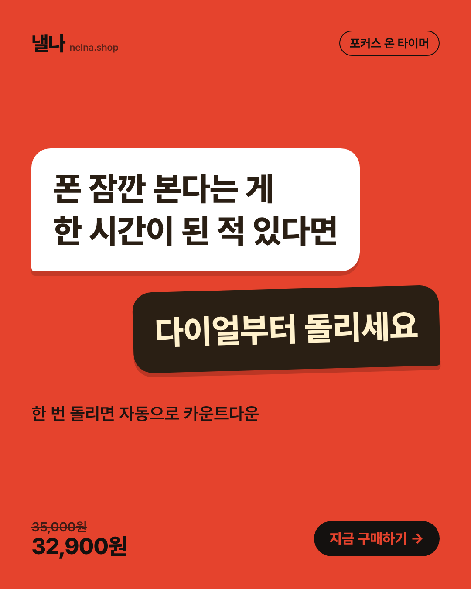

- **이미지 문구**: 폰 잠깐 본다는 게 한 시간이 된 적 있다면 / 다이얼부터 돌리세요
- **메타 헤드라인**: 폰 대신 타이머 돌리세요
- **메타 설명**: 정가 35,000원 → 지금 32,900원
- **CTA 버튼**: 지금 쇼핑하기
- **본문**:

  > 폰 잠깐 본다는 게 한 시간이 된 적 있다면, 타이머부터 돌려보세요.⏱️
  > ✅ 다이얼만 돌리면 바로 카운트다운
  > ✅ 남은 시간이 색으로 한눈에
  > ✅ 스탠드 · 스탠드바 · 후크고리 · 마그넷, 어디든 거치
  > 
  > 지금 32,900원 (정가 35,000원)
  > 👉 지금 바로 확인하기
  > 
  > 𝙣𝙚𝙡𝙣𝙖.𝙨𝙝𝙤𝙥

#### 01-timer_c2 · statement · 행동 유도(작게 시작) · 용도 확장

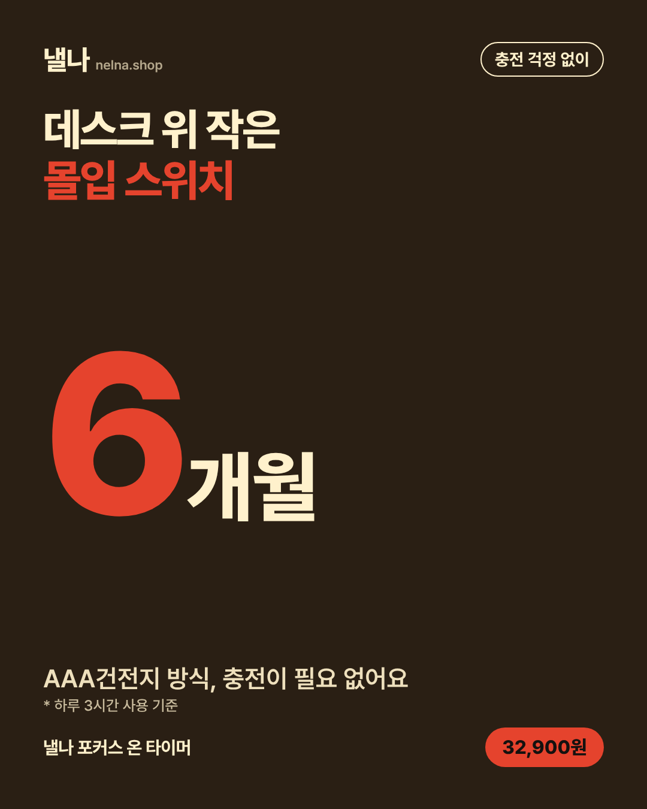

- **이미지 문구**: 딱 25분만 돌려보세요
- **메타 헤드라인**: 딱 25분만 돌려보세요
- **메타 설명**: 다이얼 한 번이면 시작 · 32,900원
- **CTA 버튼**: 지금 쇼핑하기
- **본문**:

  > 시작이 제일 어렵다면 딱 25분만 돌려보세요.⏳
  > ✅ 다이얼 한 번에 자동 카운트다운
  > ✅ 공부 · 회의 · 청소 · SNS 시간 제한까지
  > ✅ 클래식 · 버터 · 토마토, 책상 위에 두면 인테리어
  > 
  > 지금 32,900원 (정가 35,000원)
  > 👉 색상 고르러 가기
  > 
  > 𝙣𝙚𝙡𝙣𝙖.𝙨𝙝𝙤𝙥

#### 01-timer_c3 · statement · 제품 핵심 직관(시각화) · 동작 방식 확인 필요

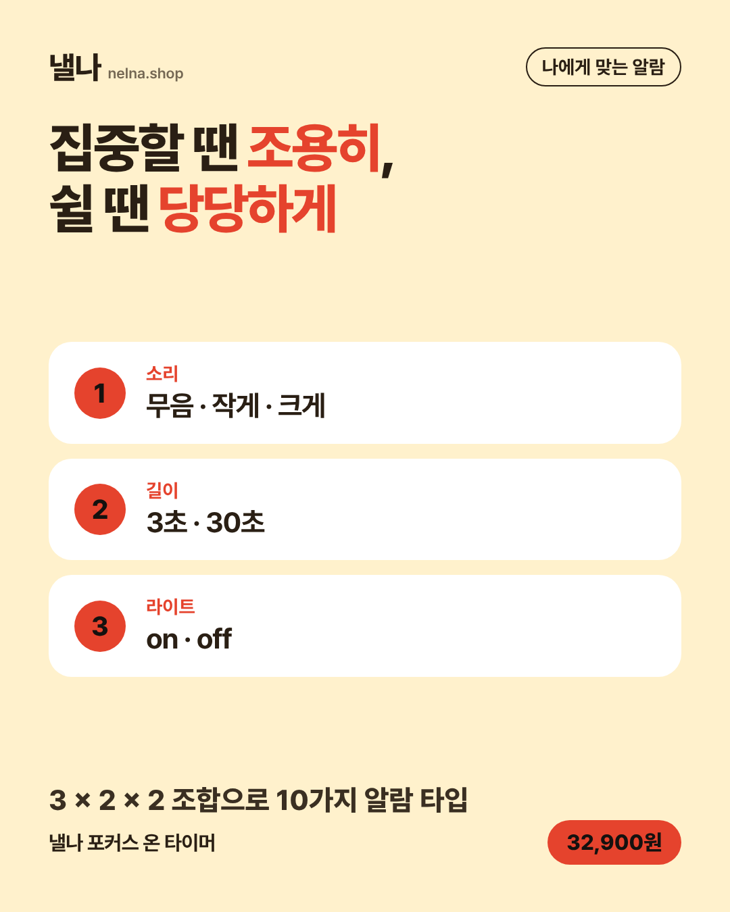

- **이미지 문구**: 남은 시간이 한눈에 보여요
- **메타 헤드라인**: 남은 시간이 한눈에 보여요
- **메타 설명**: 정가 35,000원 → 지금 32,900원
- **CTA 버튼**: 지금 쇼핑하기
- **본문**:

  > 시계 숫자를 계속 확인하지 않아도, 남은 시간이 색으로 한눈에 보여요.👀
  > ✅ 다이얼만 돌리면 자동 카운트다운
  > ✅ 공부 · 회의 · 휴식 · SNS 시간 제한까지
  > ✅ 클래식 · 버터 · 토마토 3색
  > 
  > 지금 32,900원 (정가 35,000원)
  > 👉 지금 바로 확인하기
  > 
  > 𝙣𝙚𝙡𝙣𝙖.𝙨𝙝𝙤𝙥

#### 01-timer_c4 · stat · 활용도 소구 · 거치 구성 확인 필요

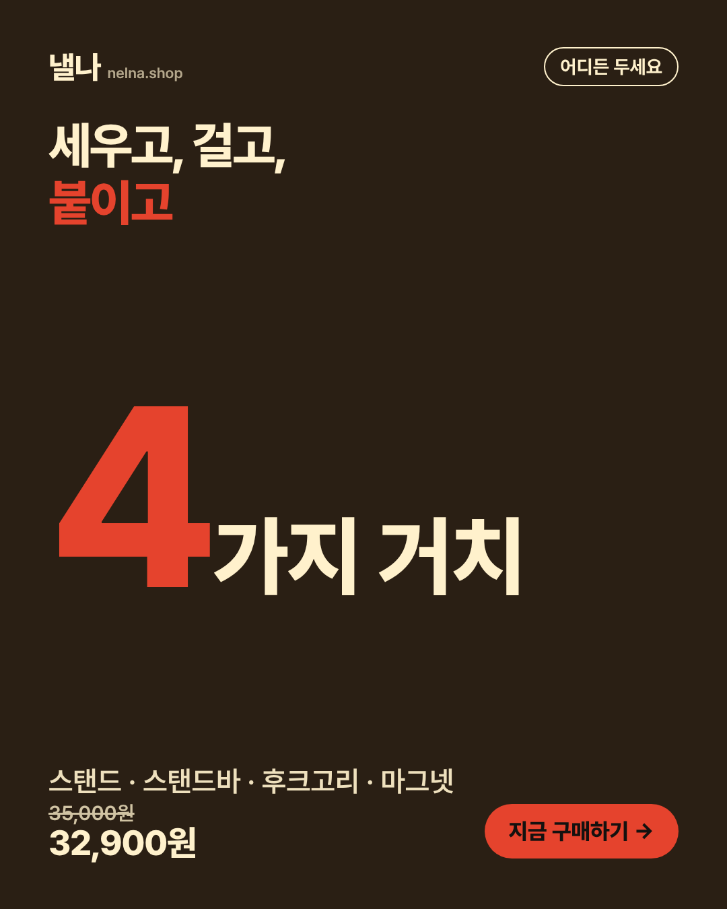

- **이미지 문구**: 세우고, 걸고, 붙이고
- **메타 헤드라인**: 세우고, 걸고, 붙이고
- **메타 설명**: 4가지 거치 방식 · 32,900원
- **CTA 버튼**: 더 알아보기
- **본문**:

  > 책상 위에 세우고, 벽에 걸고, 냉장고에 붙이고.🧲
  > ✅ 스탠드 · 스탠드바 · 후크고리 · 마그넷 4가지 거치 방식
  > ✅ 다이얼만 돌리면 자동 카운트다운
  > ✅ 클래식 · 버터 · 토마토 3색
  > 
  > 지금 32,900원 (정가 35,000원)
  > 👉 지금 바로 확인하기
  > 
  > 𝙣𝙚𝙡𝙣𝙖.𝙨𝙝𝙤𝙥

#### 01-timer_c5 · list · 디자인 · 데스크테리어 + 색상 선택 유도

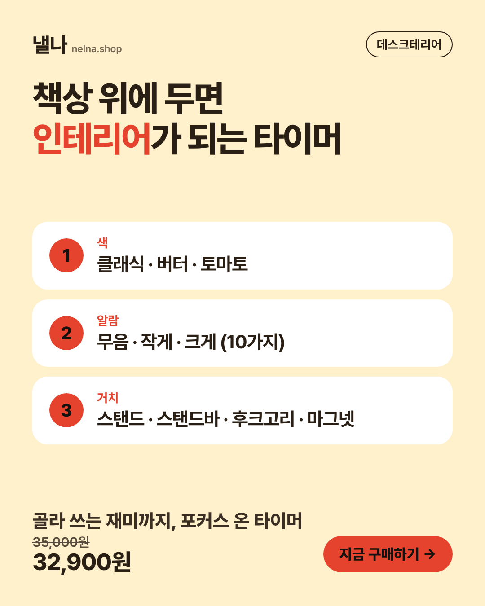

- **이미지 문구**: 책상 위에 두면 인테리어가 되는 타이머
- **메타 헤드라인**: 인테리어가 되는 타이머
- **메타 설명**: 3색 · 4가지 거치 · 32,900원
- **CTA 버튼**: 지금 쇼핑하기
- **본문**:

  > 책상 위에 두면 인테리어가 되는 타이머.🪴
  > ✅ 클래식 · 버터 · 토마토, 내 책상에 맞는 색 고르기
  > ✅ 스탠드 · 스탠드바 · 후크고리 · 마그넷 4가지 거치
  > ✅ 다이얼만 돌리면 자동 카운트다운
  > 
  > 지금 32,900원 (정가 35,000원)
  > 👉 색상 고르러 가기
  > 
  > 𝙣𝙚𝙡𝙣𝙖.𝙨𝙝𝙤𝙥

#### 01-timer_c6 · statement · 브랜드 감성 슬로건 · 몰입 경험 (우선 테스트 후보)

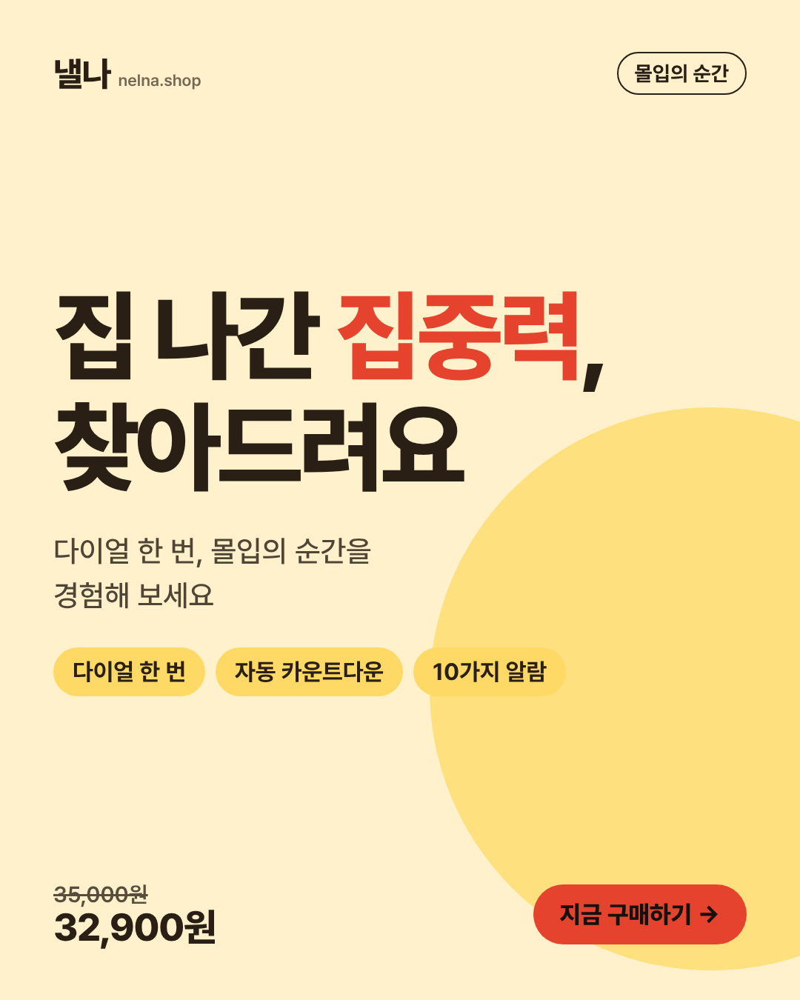

- **이미지 문구**: 집 나간 집중력, 찾아드려요
- **메타 헤드라인**: 집 나간 집중력, 찾아드려요
- **메타 설명**: 몰입의 순간을 경험해 보세요 · 32,900원
- **CTA 버튼**: 지금 쇼핑하기
- **본문**:

  > 집 나간 집중력, 포커스 온 타이머가 찾아드려요.💚
  > 다이얼을 돌리는 순간 시작되는 카운트다운, 몰입의 순간을 경험해 보세요.
  > ✅ 다이얼만 돌리면 자동 카운트다운
  > ✅ 무음 · 작게 · 크게, 내 성향대로 고르는 알람
  > ✅ 클래식 · 버터 · 토마토, 책상 위에 두면 인테리어
  > 
  > 지금 32,900원 (정가 35,000원)
  > 👉 집중력 찾으러 가기
  > 
  > 𝙣𝙚𝙡𝙣𝙖.𝙨𝙝𝙤𝙥

### 제품 사진 합성 시안

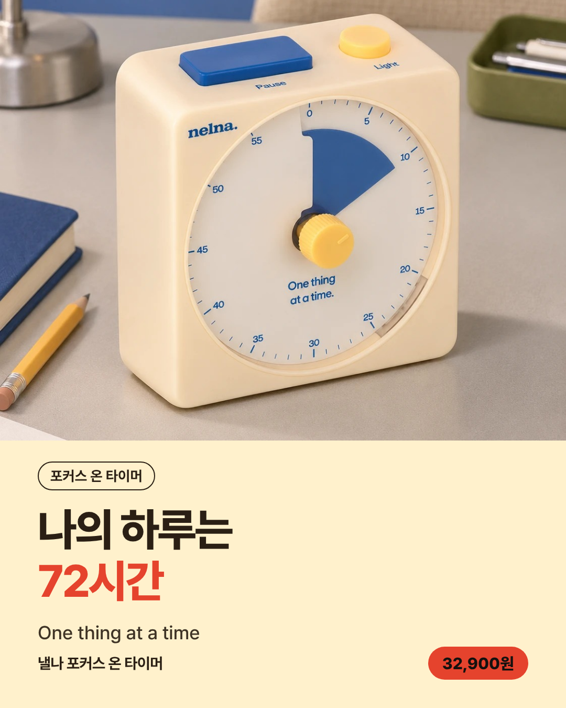

- 01-timer_t1 · 본문·헤드라인·CTA는 **c1** 와 동일 · 스토리/릴스 커버 있음

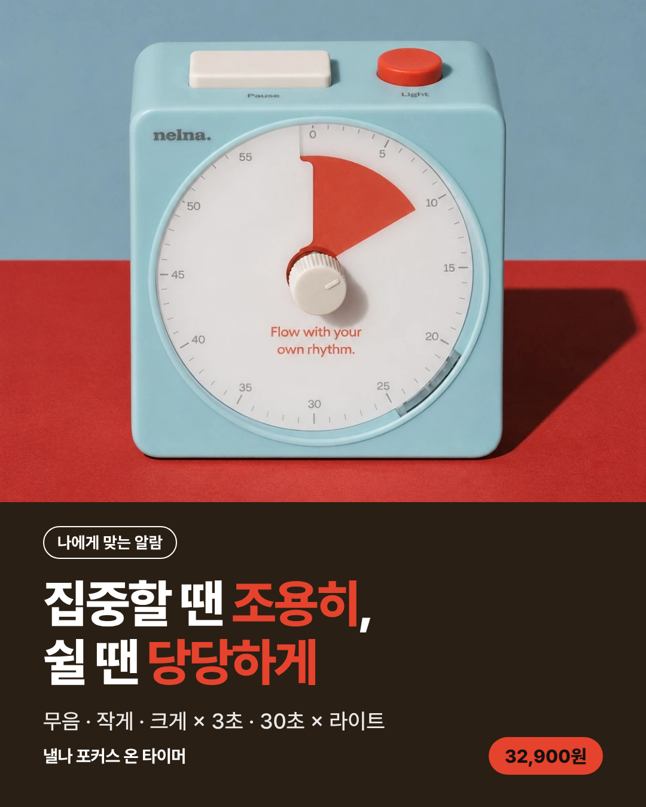

- 01-timer_t2 · 본문·헤드라인·CTA는 **c2** 와 동일 · 스토리/릴스 커버 있음

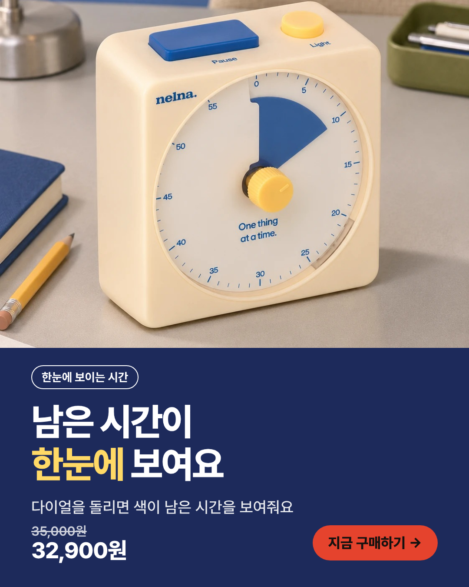

- 01-timer_t3 · 본문·헤드라인·CTA는 **c3** 와 동일

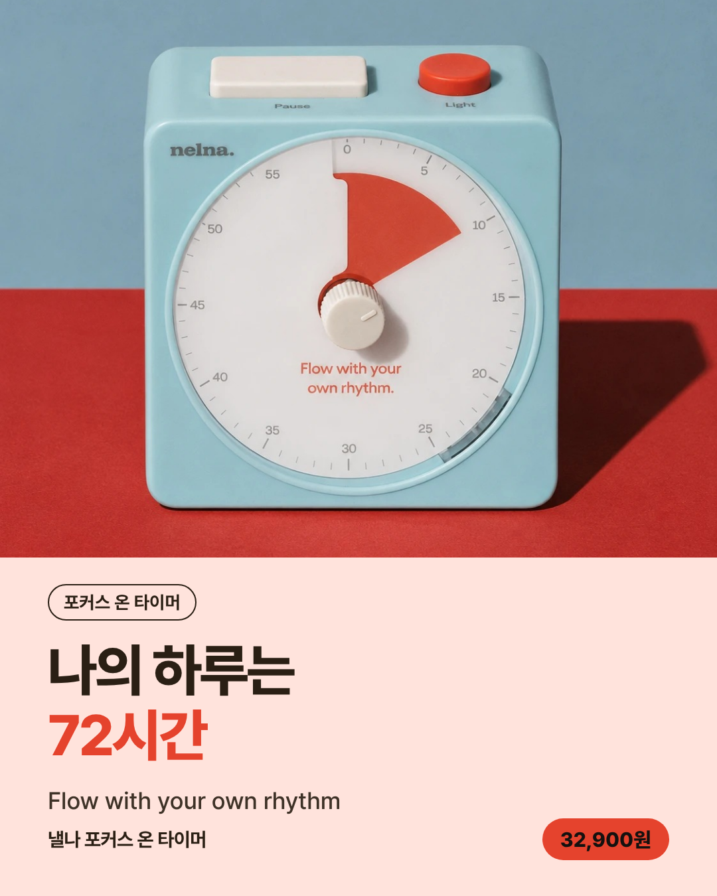

- 01-timer_t4 · 본문·헤드라인·CTA는 **c4** 와 동일

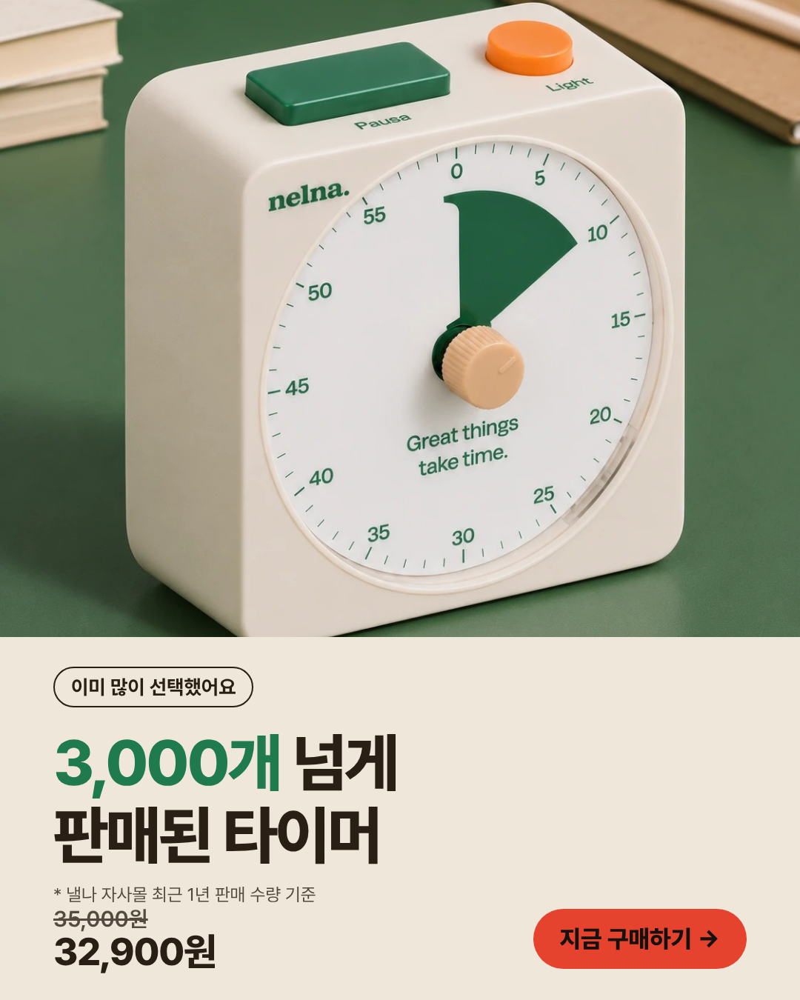

- 01-timer_t5 · 본문·헤드라인·CTA는 **c5** 와 동일 · 스토리/릴스 커버 있음

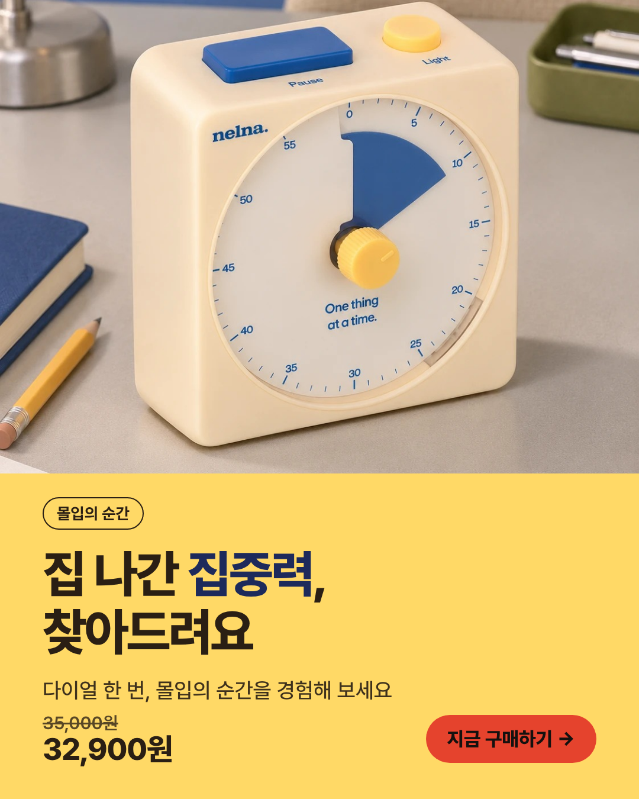

- 01-timer_t6 · 본문·헤드라인·CTA는 **c6** 와 동일 · 스토리/릴스 커버 있음

### 낼나 기존 광고 스타일 시안 (사진 풀블리드 · nelna. 로고 · 딥그린 바 / 가격·구매 버튼 없음)

#### 01-timer_n1

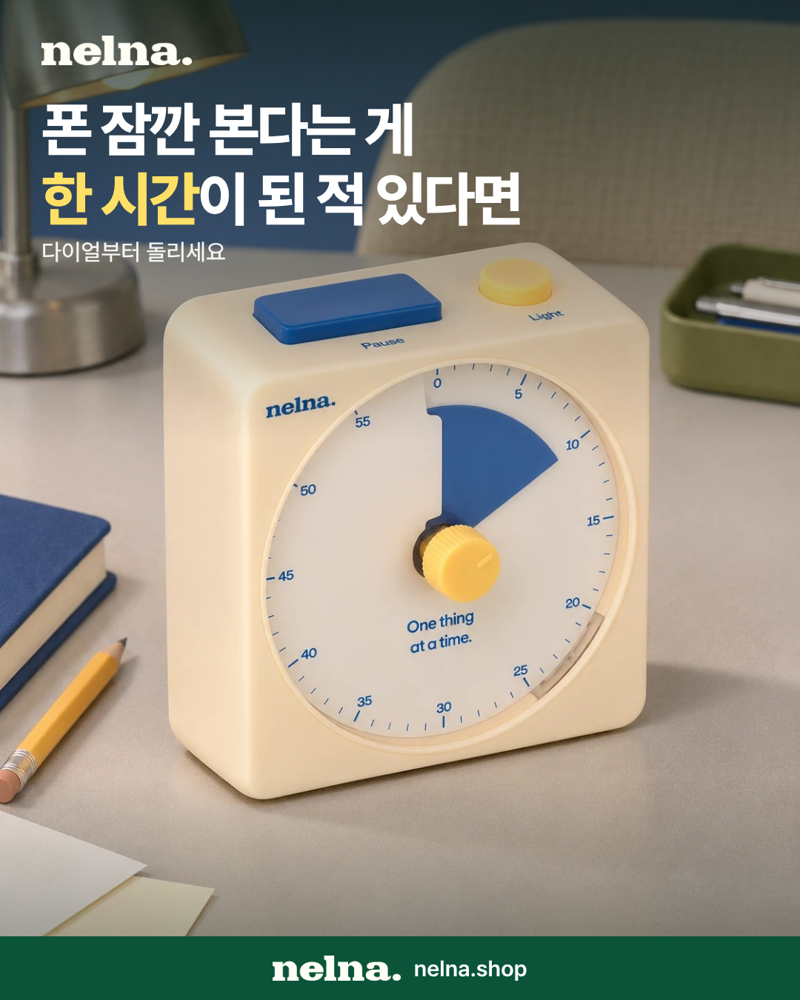

- **메타 헤드라인**: 폰 대신 타이머 돌리세요
- **메타 설명**: 다이얼 한 번이면 카운트다운 시작
- **CTA 버튼**: 더 알아보기
- **본문**:

  > 폰 잠깐 본다는 게 한 시간이 된 적 있다면, 타이머부터 돌려보세요.⏱️
  > ✅ 다이얼만 돌리면 바로 카운트다운
  > ✅ 남은 시간이 색으로 한눈에
  > ✅ 스탠드 · 스탠드바 · 후크고리 · 마그넷, 어디든 거치
  > 
  > 👉 자세히 보기
  > 
  > 𝙣𝙚𝙡𝙣𝙖.𝙨𝙝𝙤𝙥

#### 01-timer_n2

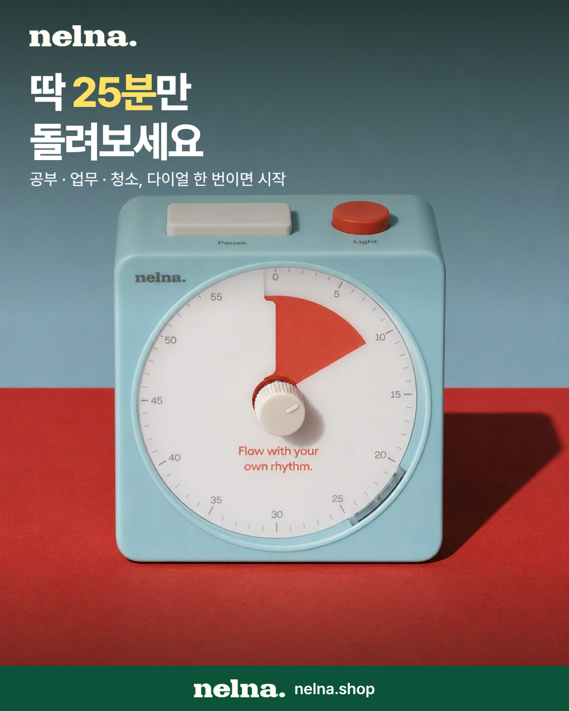

- **메타 헤드라인**: 딱 25분만 돌려보세요
- **메타 설명**: 공부 · 업무 · 청소, 다이얼 한 번이면 시작
- **CTA 버튼**: 더 알아보기
- **본문**:

  > 시작이 제일 어렵다면 딱 25분만 돌려보세요.⏳
  > ✅ 다이얼 한 번에 자동 카운트다운
  > ✅ 공부 · 회의 · 청소 · SNS 시간 제한까지
  > ✅ 클래식 · 버터 · 토마토, 책상 위에 두면 인테리어
  > 
  > 👉 자세히 보기
  > 
  > 𝙣𝙚𝙡𝙣𝙖.𝙨𝙝𝙤𝙥

#### 01-timer_n3

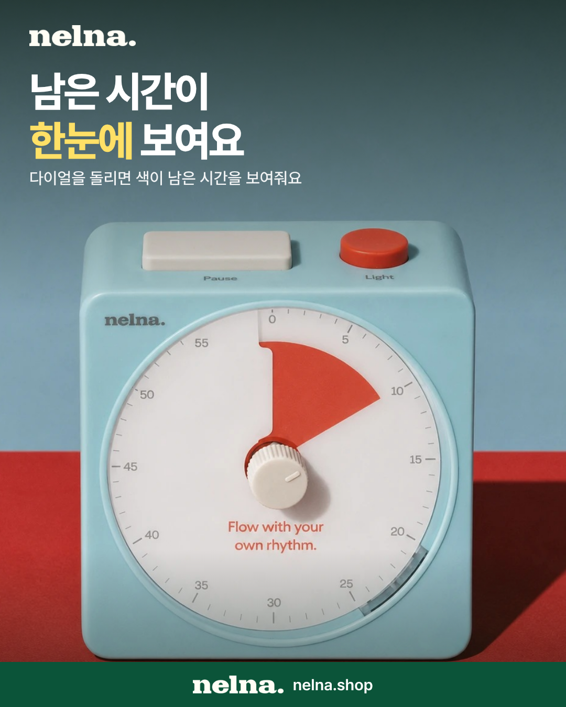

- **메타 헤드라인**: 남은 시간이 한눈에 보여요
- **메타 설명**: 다이얼 색으로 남은 시간이 한눈에
- **CTA 버튼**: 더 알아보기
- **본문**:

  > 시계 숫자를 계속 확인하지 않아도, 남은 시간이 색으로 한눈에 보여요.👀
  > ✅ 다이얼만 돌리면 자동 카운트다운
  > ✅ 공부 · 회의 · 휴식 · SNS 시간 제한까지
  > ✅ 클래식 · 버터 · 토마토 3색
  > 
  > 👉 자세히 보기
  > 
  > 𝙣𝙚𝙡𝙣𝙖.𝙨𝙝𝙤𝙥

#### 01-timer_n6

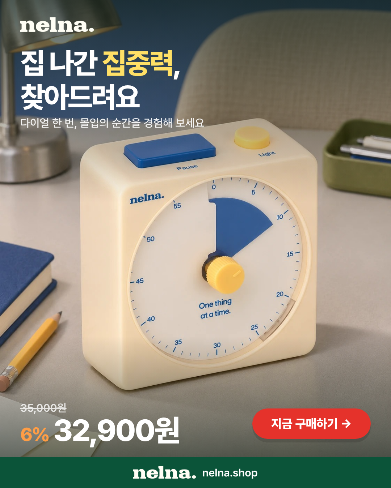

- **메타 헤드라인**: 집 나간 집중력, 찾아드려요
- **메타 설명**: 몰입의 순간을 경험해 보세요
- **CTA 버튼**: 더 알아보기
- **본문**:

  > 집 나간 집중력, 포커스 온 타이머가 찾아드려요.💚
  > 다이얼을 돌리는 순간 시작되는 카운트다운, 몰입의 순간을 경험해 보세요.
  > ✅ 다이얼만 돌리면 자동 카운트다운
  > ✅ 무음 · 작게 · 크게, 내 성향대로 고르는 알람
  > ✅ 클래식 · 버터 · 토마토, 책상 위에 두면 인테리어
  > 
  > 👉 자세히 보기
  > 
  > 𝙣𝙚𝙡𝙣𝙖.𝙨𝙝𝙤𝙥

#### 01-timer_n7

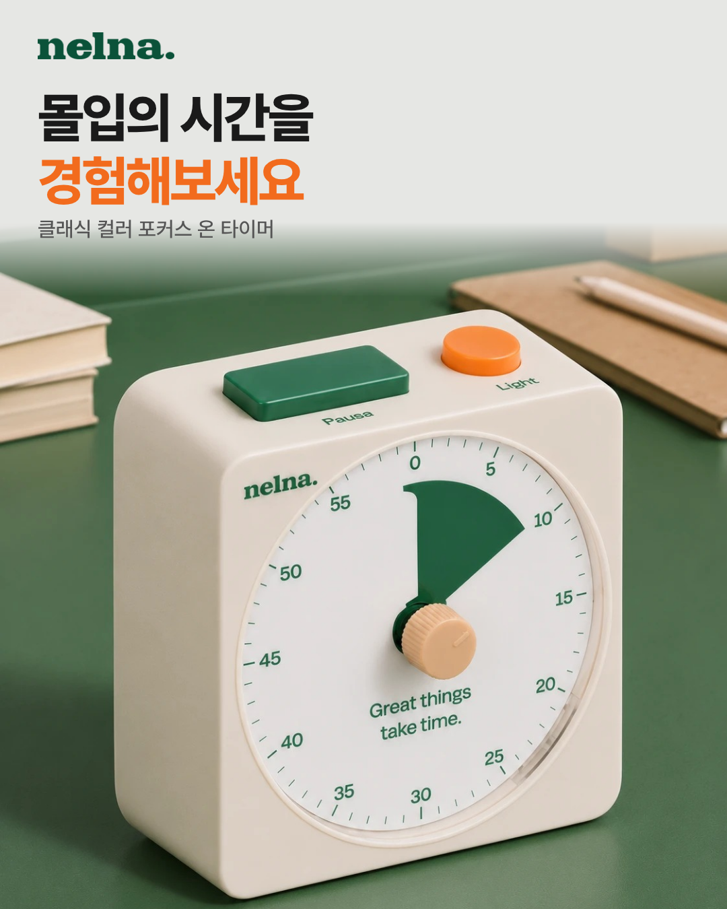

- **메타 헤드라인**: 클래식 컬러로 만나는 몰입의 시간
- **메타 설명**: 클래식 컬러 포커스 온 타이머
- **CTA 버튼**: 더 알아보기
- **본문**:

  > 클래식 컬러로 만나는 몰입의 시간.🌿
  > 다이얼을 돌리는 순간 시작되는 카운트다운, 몰입의 시간을 경험해보세요.
  > ✅ 다이얼만 돌리면 자동 카운트다운
  > ✅ 남은 시간이 색으로 한눈에
  > ✅ 무음 · 작게 · 크게, 내 성향대로 고르는 알람
  > 
  > 👉 자세히 보기
  > 
  > 𝙣𝙚𝙡𝙣𝙖.𝙨𝙝𝙤𝙥

### 영상 스크립트 (15초 · 9:16 릴스 (전환형))

| 구간 | 내용 |
|---|---|
| 0–3초 | [훅] 소파에서 폰을 보던 손이 멈추고 시계가 한 시간 지나 있음. 자막 “폰 잠깐 본다는 게 한 시간…” |
| 3–7초 | [해결] 책상 위 타이머 다이얼을 돌림 → 자동 카운트다운 시작. 자막 “딱 25분만 돌려보세요” |
| 7–12초 | [혜택] 자막이 하나씩: “남은 시간이 한눈에” → “세우고, 걸고, 붙이고” (스탠드 / 후크고리 / 마그넷으로 여기저기 거치) → “클래식 · 버터 · 토마토” |
| 12–15초 | [오퍼] 3색 나란히 + 자막 “집 나간 집중력, 찾아드려요” + “정가 35,000원 → 32,900원” + “지금 구매하기” |

---

## 낼나 무궁무진 거치대 (109,000원)

### 집행 전 확인

- **무게 · 정확한 사이즈 · 권장 하중** 수치가 상세페이지에 없습니다. 수치 주장은 확인 후 추가하세요.
- “아이폰만큼 얇은”은 **어떤 모델과 비교인지, 접은 상태 두께 기준인지** 확인이 필요합니다(비교 표시). 소재에는 4.6mm 수치를 메인으로 두었습니다.
- 노트북 · 태블릿 지원 기종 범위를 상세페이지에서 확인해 본문에 넣어두면 문의가 줄어듭니다.

### 소재

#### 02-stand_c1 · chat · 문제 공감(여러 개 사는 불편) → 올인원 해결

- **이미지 문구**: 책 읽을 때도, 태블릿 쓸 때도, 노트북으로 일할 때도. / 매번 다른 거치대가 필요했나요?
- **메타 헤드라인**: 거치대, 이제 하나만
- **메타 설명**: 독서대·태블릿·노트북·오거나이저 올인원
- **CTA 버튼**: 지금 쇼핑하기
- **본문**:

  > 책 읽을 땐 독서대, 영상 볼 땐 태블릿 거치대, 일할 땐 노트북 스탠드.
  > 하나로 끝내는 방법이 있어요. 6가지 모듈을 조합하는 낼나 무궁무진 거치대.

#### 02-stand_c2 · stat · 휴대성 수치 소구 · 비교 모델 표기 확인 필요

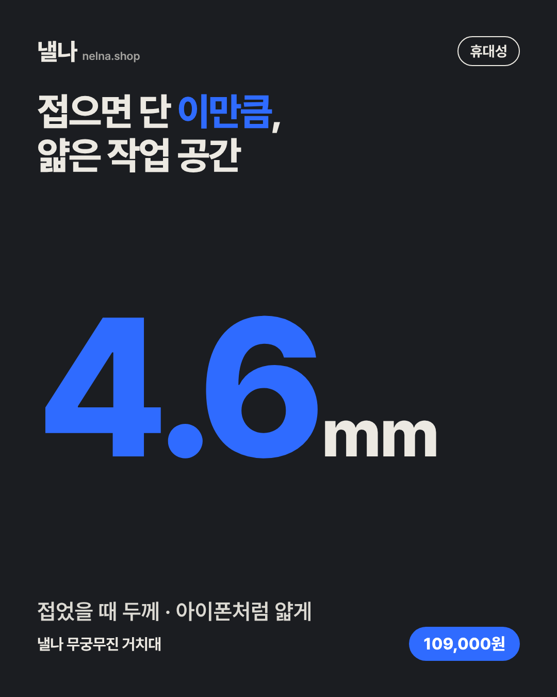

- **이미지 문구**: 접으면 단 이만큼, 얇은 작업 공간
- **메타 헤드라인**: 접으면 4.6mm
- **메타 설명**: 가방 속 작업 공간
- **CTA 버튼**: 더 알아보기
- **본문**:

  > 접으면 두께 4.6mm.
  > 가방 속에 넣고 다니는 작업 공간, 낼나 무궁무진 거치대입니다.

#### 02-stand_c3 · statement · 라이프스타일 · 4단계 각도

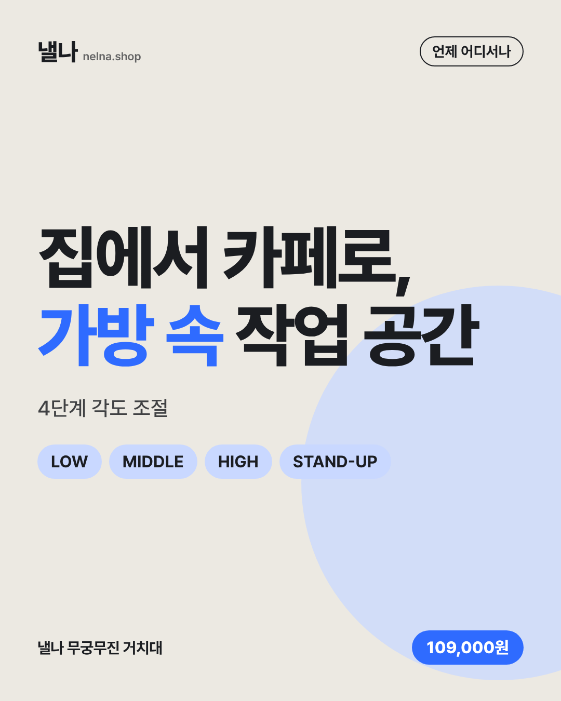

- **이미지 문구**: 집에서 카페로, 가방 속 작업 공간
- **메타 헤드라인**: 집에서 카페로, 가방 속 작업실
- **메타 설명**: 4단계 각도 조절
- **CTA 버튼**: 지금 쇼핑하기
- **본문**:

  > 집에서 카페로, 도서관으로.
  > LOW · MIDDLE · HIGH · STAND-UP 4단계 각도 조절로 작업 방식에 맞게 바꿔 쓰세요.

### 제품 사진 합성 시안

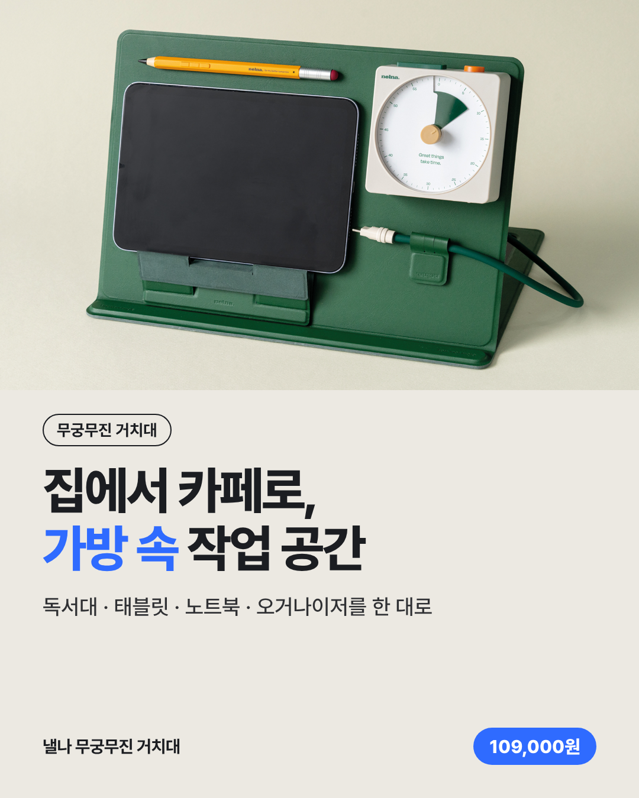

- 02-stand_p1 · 본문·헤드라인·CTA는 **c3** 와 동일 · 스토리/릴스 커버 있음

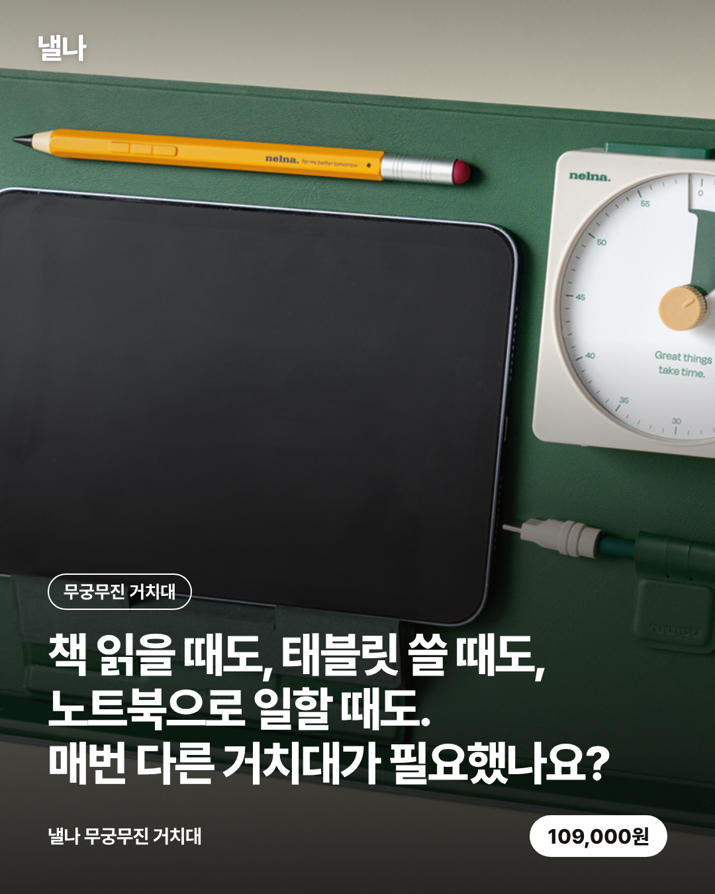

- 02-stand_p2 · 본문·헤드라인·CTA는 **c1** 와 동일

### 영상 스크립트 (20초 · 9:16 릴스)

| 구간 | 내용 |
|---|---|
| 0–3초 | [훅] 책상 위에 독서대 · 태블릿 거치대 · 노트북 스탠드가 어지럽게 놓임. 자막 “매번 다른 거치대, 필요했나요?” |
| 3–10초 | [변신] 얇은 판 하나를 펼침 → 독서대 → 태블릿 → 노트북 → 오거나이저. LOW / MIDDLE / HIGH / STAND-UP 각도 전환 |
| 10–16초 | [휴대성] 접어서 가방에 쏙. 자막 “접으면 4.6mm”. 카페 장면으로 컷 |
| 16–20초 | [CTA] 6가지 구성품 펼침 샷 + 109,000원 |

---

## 낼나 펜슬 아이패드용 (82,900원)

### 집행 전 확인

- “애플펜슬 2세대보다 3g 가벼움”은 **비교 표시**입니다. 측정 근거(저울 사진 · 측정 조건)를 보관하고, 상표 사용 규정에 맞게 문구를 쓰세요. 필요하면 “3g 가벼운”만 쓰고 비교 대상을 상세 설명으로 내릴 수 있습니다.
- 레드닷 수상은 **2025 “컨셉” 부문**입니다. “레드닷 어워드 컨셉 부문 수상”으로 정확히 표기했습니다(“레드닷 제품상” 같은 축약 금지).
- “10만 번 눌러도 끄떡없는”은 시험 근거(성적서 · 내부 시험 조건)를 확인하세요. 소재에는 “10만 회 누름 테스트” 문구로 쓸 수 있습니다.
- “정가 대비 24% 할인”은 할인 기간과 정가 근거가 필요합니다(소재에는 넣지 않았습니다).
- 호환 아이패드 기종 목록을 본문 또는 댓글 고정에 넣어두세요.

### 소재

#### 03-pencil_c1 · statement · 감성 훅(소리) · 디자인 차별화

- **이미지 문구**: 사각사각 소리가 들리는 것 같지 않나요?
- **메타 헤드라인**: 연필 감성 10,000% 아이패드 펜슬
- **메타 설명**: 육각 연필 디자인 · 무선 마그네틱 충전
- **CTA 버튼**: 지금 쇼핑하기
- **본문**:

  > ‘펜슬’은 ‘연필’이니까, 근본으로 돌아가기.
  > 연필 모양 그대로의 육각 디자인, 아이패드에서도 사각사각 쓰는 맛.

#### 03-pencil_c2 · stat · 신뢰(수상) + 스펙 비교 · 근거 보관 필요

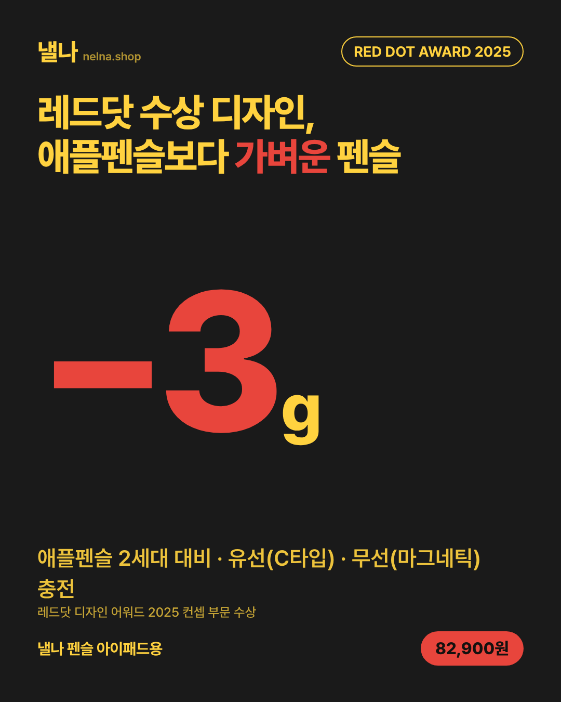

- **이미지 문구**: 레드닷 수상 디자인, 애플펜슬보다 가벼운 펜슬
- **메타 헤드라인**: 레드닷 수상, 3g 더 가벼운 펜슬
- **메타 설명**: C타입 · 마그네틱 충전 모두 지원
- **CTA 버튼**: 더 알아보기
- **본문**:

  > 레드닷 디자인 어워드 2025 컨셉 부문 수상.
  > 애플펜슬 2세대보다 3g 가볍고, 유선(C타입)·무선(마그네틱) 충전을 모두 지원해요.

#### 03-pencil_c3 · stat · 기능 소구 · 시험 근거 확인 필요

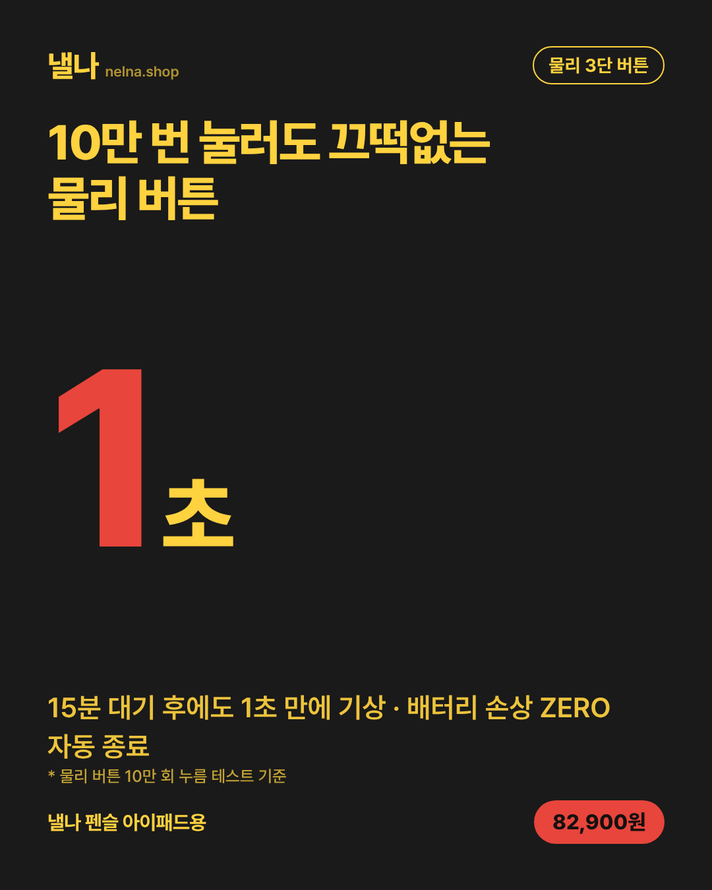

- **이미지 문구**: 10만 번 눌러도 끄떡없는 물리 버튼
- **메타 헤드라인**: 1초 만에 깨어나는 펜슬
- **메타 설명**: 물리 3단 버튼 · 앱별 기능 커스텀
- **CTA 버튼**: 지금 쇼핑하기
- **본문**:

  > 터치가 아니라 진짜 버튼. 10만 번 눌러도 끄떡없는 물리 3단 버튼에 앱별 기능까지 커스텀.
  > 쓰지 않을 땐 알아서 꺼지고, 다시 잡으면 1초 만에 깨어납니다.

### 제품 사진 합성 시안

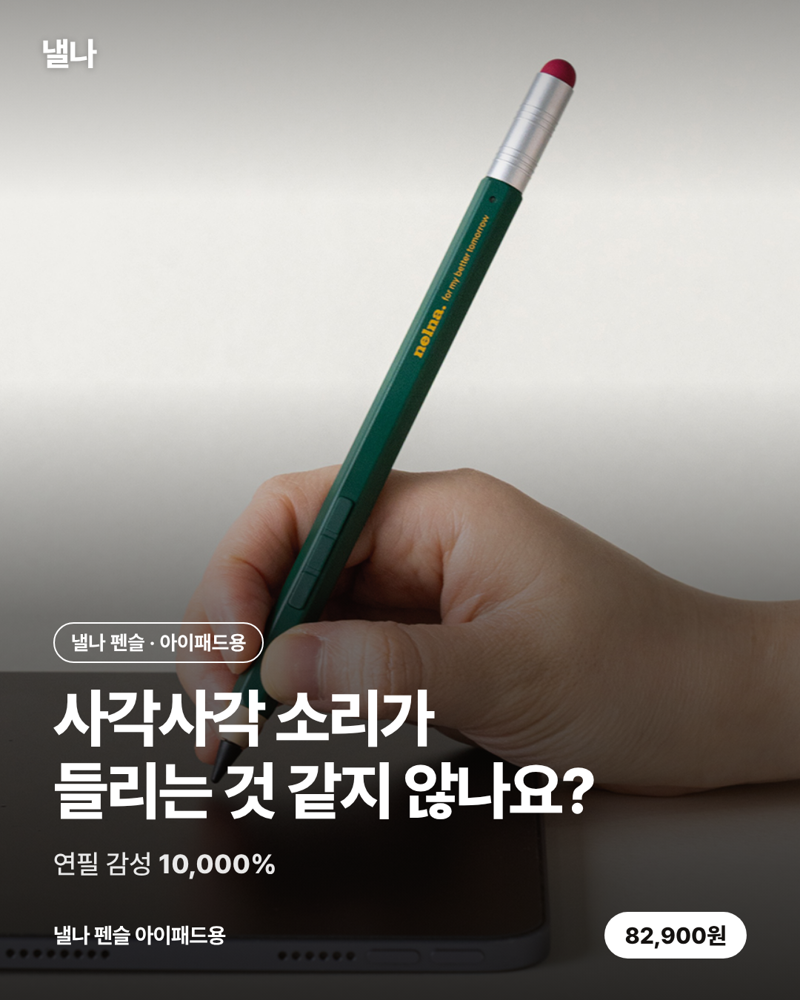

- 03-pencil_p1 · 본문·헤드라인·CTA는 **c1** 와 동일 · 스토리/릴스 커버 있음

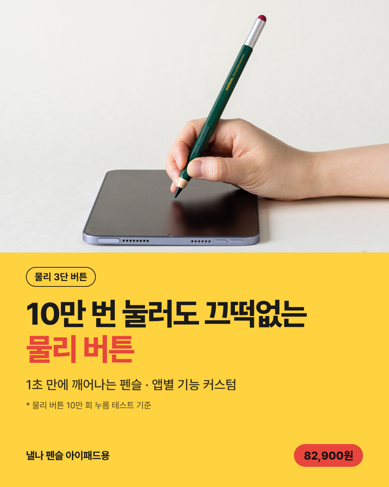

- 03-pencil_p2 · 본문·헤드라인·CTA는 **c3** 와 동일

### 영상 스크립트 (15초 · 9:16 릴스)

| 구간 | 내용 |
|---|---|
| 0–3초 | [훅] 연필 깎는 소리 ASMR + 자막 “사각사각 소리가 들리는 것 같지 않나요?” |
| 3–8초 | [디자인] 육각 몸체 클로즈업, 연필과 나란히 놓고 비교. 자막 “레드닷 어워드 2025 컨셉 부문 수상” |
| 8–12초 | [기능] 물리 3단 버튼 누르는 클로즈업, 앱별 기능 전환. 자막 “1초 만에 깨어나는 펜슬” |
| 12–15초 | [CTA] 마그네틱 부착 + 82,900원 |

---

## 낼나 스크런치 케이블 세트 (38,900원)

### 집행 전 확인

- 60W · 480Mbps는 **스펙 수치**입니다. 충전 속도는 기기 · 충전기(PD 지원 여부)에 따라 달라지니 “호환 기기에 따라 속도 상이” 각주를 권장합니다.
- 롱(120cm·73g) / 숏(38cm·46g), 스트랩 커버 4색 정보를 캐러셀 2~3장에 분리해 보여주면 좋습니다.
- “낙하 방지”는 파손 방지를 보장하는 표현이 아니라 “떨어뜨릴 걱정을 덜어주는” 정도로 쓰세요.

### 소재

#### 04-scrunchie_c1 · chat · 문제 공감(2가지 사고) → 1개로 해결

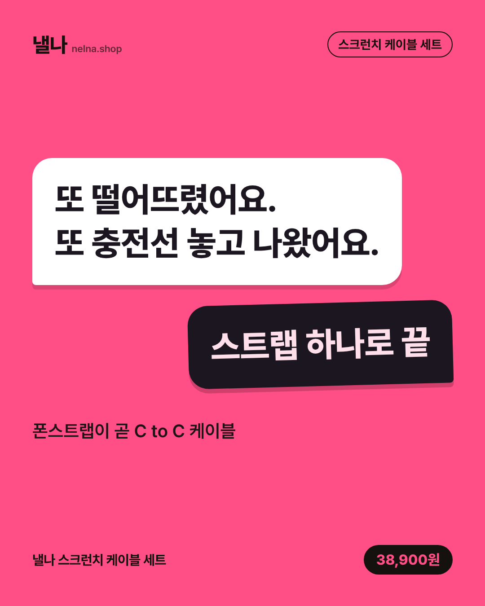

- **이미지 문구**: 또 떨어뜨렸어요. 또 충전선 놓고 나왔어요. / 스트랩 하나로 끝
- **메타 헤드라인**: 스트랩 하나로 끝
- **메타 설명**: 폰스트랩 + C to C 충전 케이블
- **CTA 버튼**: 지금 쇼핑하기
- **본문**:

  > 폰 떨어뜨리고, 충전선 놓고 나오고. 매번 반복되는 일상 사고.
  > 폰스트랩이 곧 충전 케이블이라면 둘 다 해결됩니다. 가볍게 툭 걸치고, 필요할 땐 1초 변신.

#### 04-scrunchie_c2 · statement · 디자인 소구

- **이미지 문구**: 예쁘면서 충전까지 되는 폰 스트랩
- **메타 헤드라인**: 케이블이 숨어있는 폰스트랩
- **메타 설명**: 가볍게 툭 걸치고 필요할 땐 1초 변신
- **CTA 버튼**: 더 알아보기
- **본문**:

  > 평소엔 예쁜 스트랩, 필요할 땐 당기면 충전 케이블.
  > 고급 무광 메탈 · 360도 회전 카라비너 · 보풀 방지 직조까지, 케이블이 숨어있는 단 하나뿐인 폰스트랩.

#### 04-scrunchie_c3 · stat · 스펙 소구 · 각주 필수

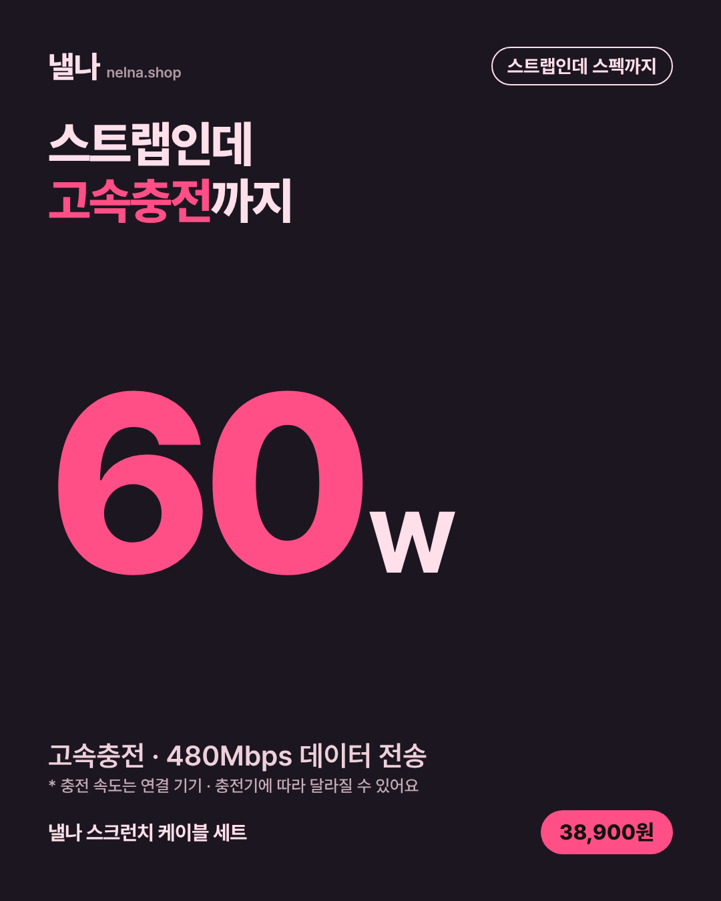

- **이미지 문구**: 스트랩인데 고속충전까지
- **메타 헤드라인**: 60W 고속충전 폰스트랩
- **메타 설명**: 480Mbps 데이터 전송 지원
- **CTA 버튼**: 지금 쇼핑하기
- **본문**:

  > 폰스트랩인데 60W 고속충전, 480Mbps 데이터 전송까지.
  > 가방 속 케이블 + 보조배터리 + 스트랩을 하나로 줄여보세요.

### 제품 사진 합성 시안

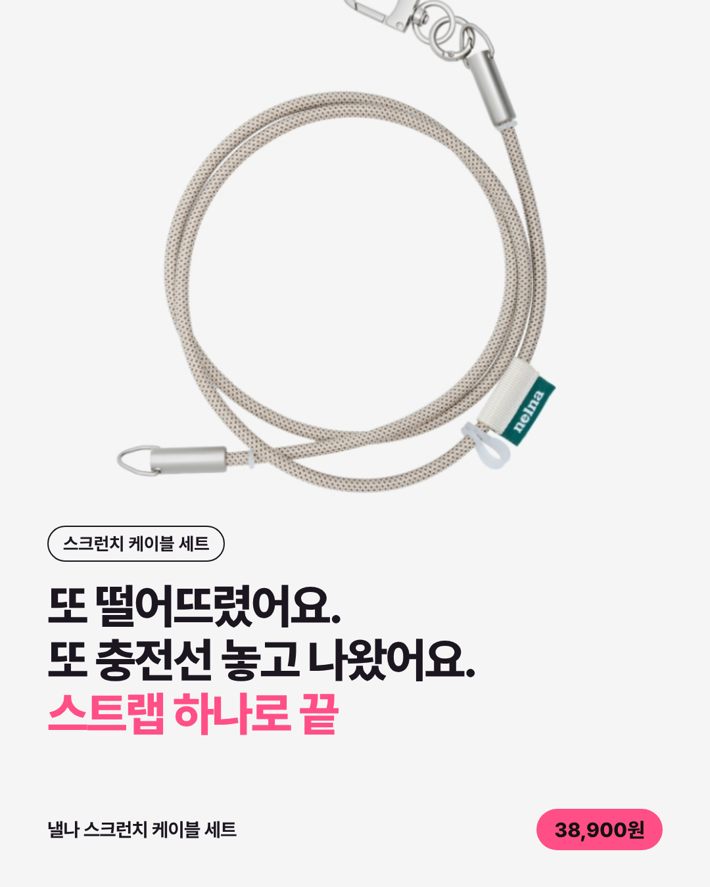

- 04-scrunchie_p1 · 본문·헤드라인·CTA는 **c1** 와 동일 · 스토리/릴스 커버 있음

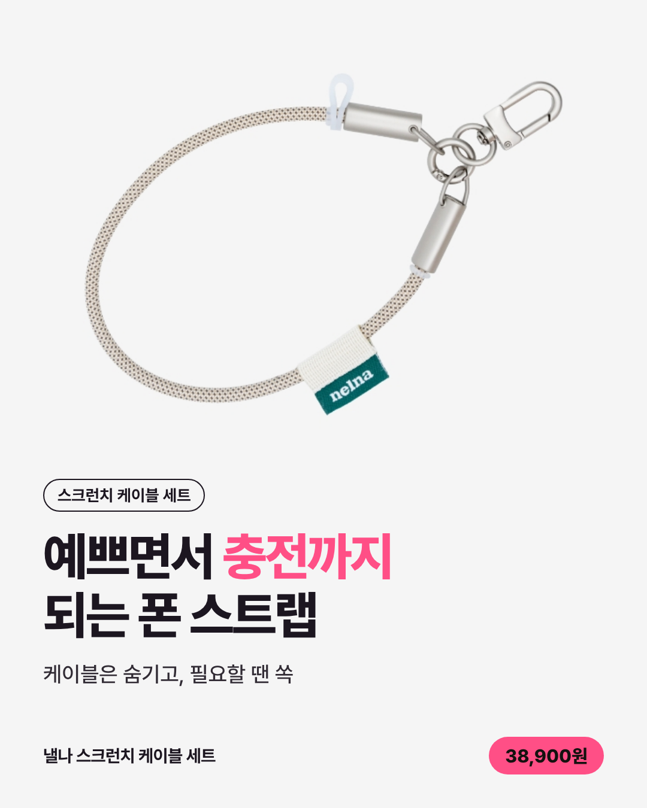

- 04-scrunchie_p2 · 본문·헤드라인·CTA는 **c2** 와 동일

### 영상 스크립트 (15초 · 9:16 릴스)

| 구간 | 내용 |
|---|---|
| 0–3초 | [훅] 가방을 뒤지다 포기하는 장면. 자막 “또 충전선 놓고 나왔어요” |
| 3–8초 | [반전] 손목에 걸린 폰스트랩을 쭉 당김 → 짠, C to C 케이블. 폰에 꽂아 충전 시작 |
| 8–12초 | [스타일링] 롱 / 숏, 스트랩 커버 4색 교체. 크로스백으로 메는 장면 |
| 12–15초 | [CTA] 자막 “스트랩 하나로 끝” + 38,900원 |

---

## 낼나 나다운 연력 2027 (19,500원)

### 집행 전 확인

- 상세페이지의 “2019년부터 4년 넘게 직접 써온 노하우”는 **지금(2026년 11월) 기준으로는 오래된 표현**이라 소재에는 쓰지 않았습니다. 수정 후 사용하세요.
- 증정 책상용 미니 연력은 **수량 한정 여부** 확인 후 “증정” 문구를 쓰세요.
- 연말 회고 시즌(11~12월) 소재입니다. 1월 이후엔 “올해의 목표” 소구로 교체하세요.

### 소재

#### 05-yeonryeok_c1 · statement · 제품 컨셉 직관 전달

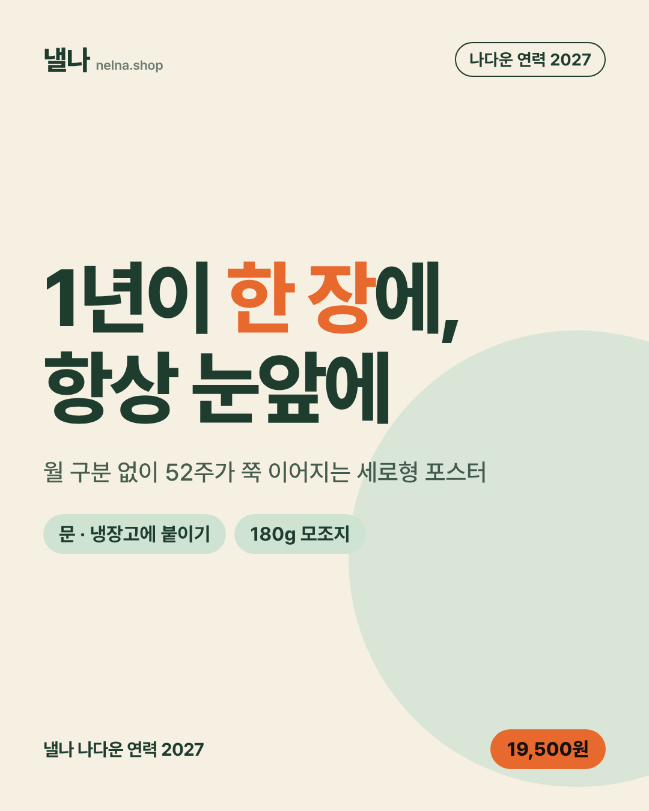

- **이미지 문구**: 1년이 한 장에, 항상 눈앞에
- **메타 헤드라인**: 1년이 한 장에, 항상 눈앞에
- **메타 설명**: 52주가 이어지는 세로형 연력
- **CTA 버튼**: 지금 쇼핑하기
- **본문**:

  > 월이 바뀌어도 끊기지 않는 52주. 문이나 냉장고에 붙여두면 한 해의 흐름이 한눈에 보여요.
  > 1년이 한 장에, 항상 눈앞에. 낼나 나다운 연력 2027.

#### 05-yeonryeok_c2 · chat · 부담 없는 기록 톤 · 다이어리 포기 경험 공감

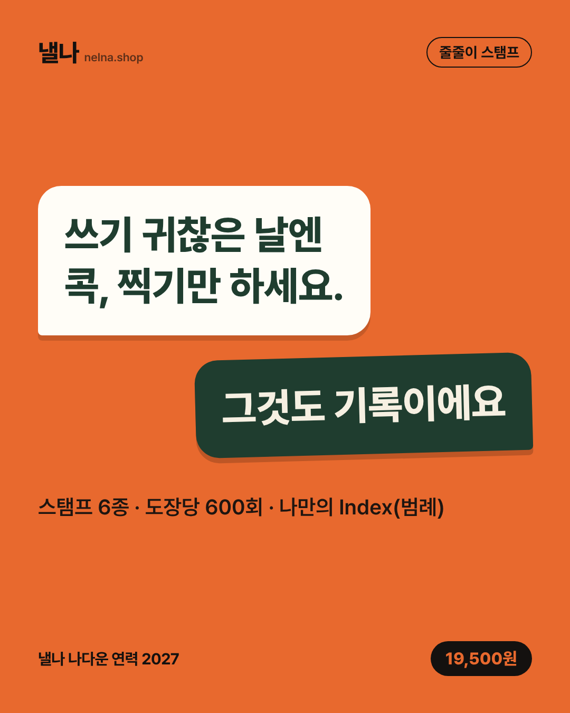

- **이미지 문구**: 쓰기 귀찮은 날엔 콕, 찍기만 하세요. / 그것도 기록이에요
- **메타 헤드라인**: 찍기만 해도 기록이에요
- **메타 설명**: 줄줄이 스탬프 6종
- **CTA 버튼**: 더 알아보기
- **본문**:

  > 매일 쓰다 보면 지치는 날, 있잖아요.
  > 그런 날엔 콕, 찍기만 하세요. 다 채우지 않아도 괜찮아요. 그것도 기록이에요.

#### 05-yeonryeok_c3 · list · 연말 회고 영상/게시물용

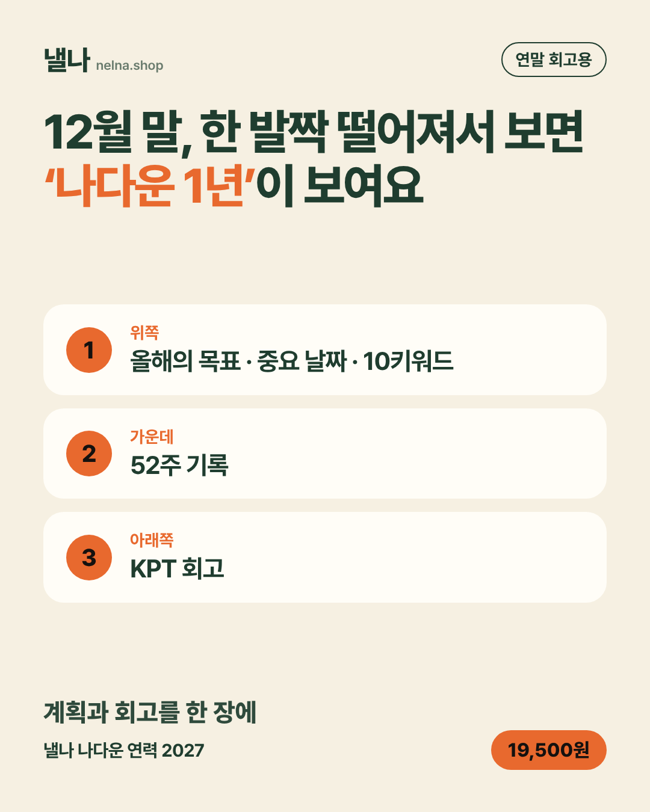

- **이미지 문구**: 12월 말, 한 발짝 떨어져서 보면 ‘나다운 1년’이 보여요
- **메타 헤드라인**: 나다운 1년이 한눈에
- **메타 설명**: 계획 + 기록 + 회고 한 장
- **CTA 버튼**: 지금 쇼핑하기
- **본문**:

  > 12월 말, 한 발짝 떨어져서 보면 ‘나다운 1년’이 보여요.
  > 위쪽엔 목표와 키워드, 가운데는 52주 기록, 아래쪽엔 KPT 회고까지. 계획과 회고를 한 장에 담았어요.

### 제품 사진 합성 시안

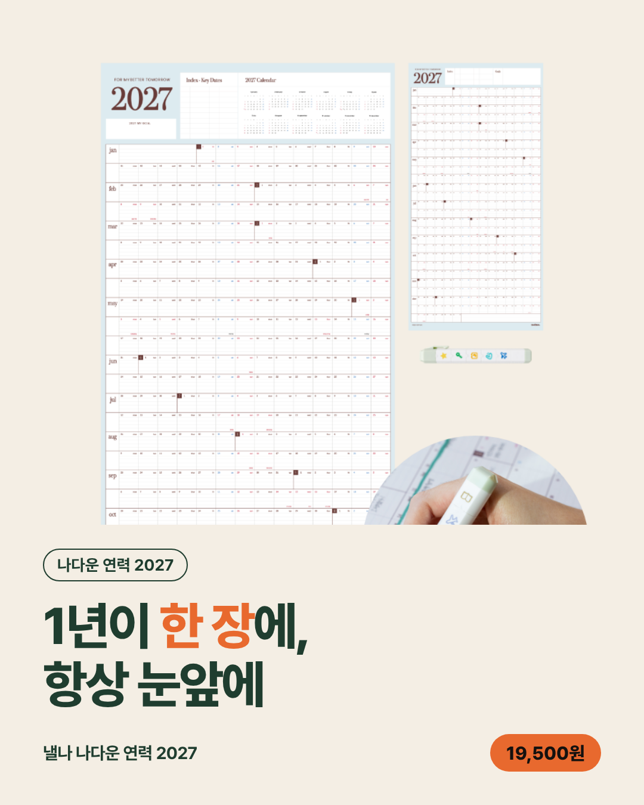

- 05-yeonryeok_p1 · 본문·헤드라인·CTA는 **c1** 와 동일 · 스토리/릴스 커버 있음

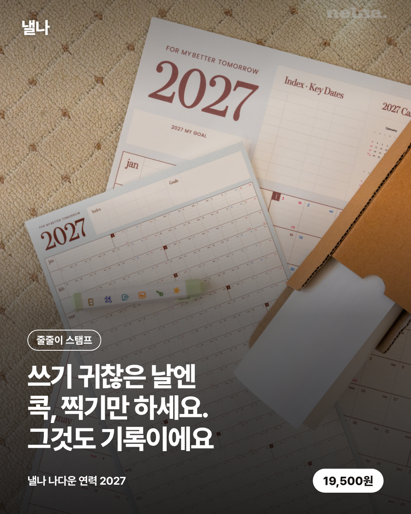

- 05-yeonryeok_p2 · 본문·헤드라인·CTA는 **c2** 와 동일

### 낼나 기존 광고 스타일 시안 (사진 풀블리드 · nelna. 로고 · 딥그린 바 / 가격·구매 버튼 없음)

#### 05-yeonryeok_n1

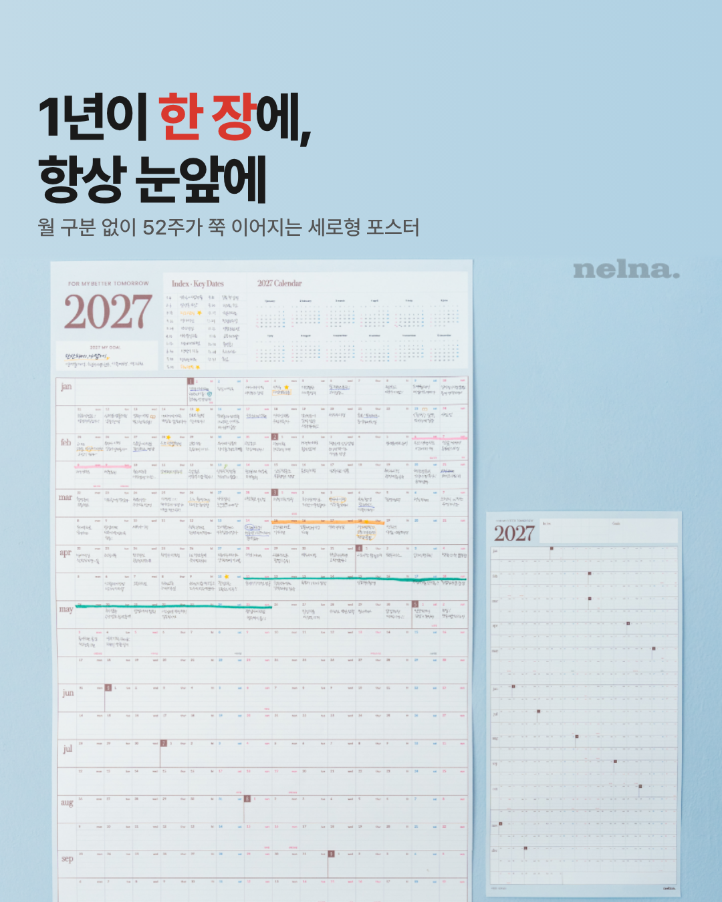

- **메타 헤드라인**: 1년이 한 장에, 항상 눈앞에
- **메타 설명**: 월 구분 없이 52주가 이어지는 연력
- **CTA 버튼**: 더 알아보기
- **본문**:

  > 1년이 한 장에, 항상 눈앞에.📅
  > ✅ 월 구분 없이 52주가 쭉 이어지는 세로형 포스터
  > ✅ 문이나 벽에 붙여두면 한 해의 흐름이 끊김 없이
  > ✅ 쓰기 부담 없는 줄줄이 스탬프 6종
  > 
  > 👉 자세히 보기
  > 
  > 𝙣𝙚𝙡𝙣𝙖.𝙨𝙝𝙤𝙥

#### 05-yeonryeok_n2

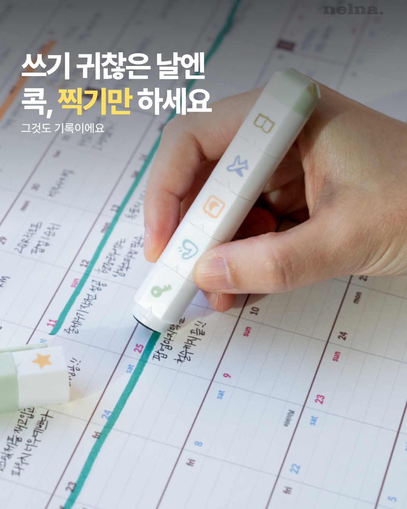

- **메타 헤드라인**: 찍기만 해도 기록이에요
- **메타 설명**: 줄줄이 스탬프 6종 · 도장당 600회
- **CTA 버튼**: 더 알아보기
- **본문**:

  > 쓰기 귀찮은 날엔 콕, 찍기만 하세요. 그것도 기록이에요.🖍️
  > ✅ 줄줄이 스탬프 6종, 도장당 600회
  > ✅ 나만의 의미를 정하는 Index(범례)
  > ✅ 다 채우지 않아도 괜찮아요
  > 
  > 👉 자세히 보기
  > 
  > 𝙣𝙚𝙡𝙣𝙖.𝙨𝙝𝙤𝙥

#### 05-yeonryeok_n3

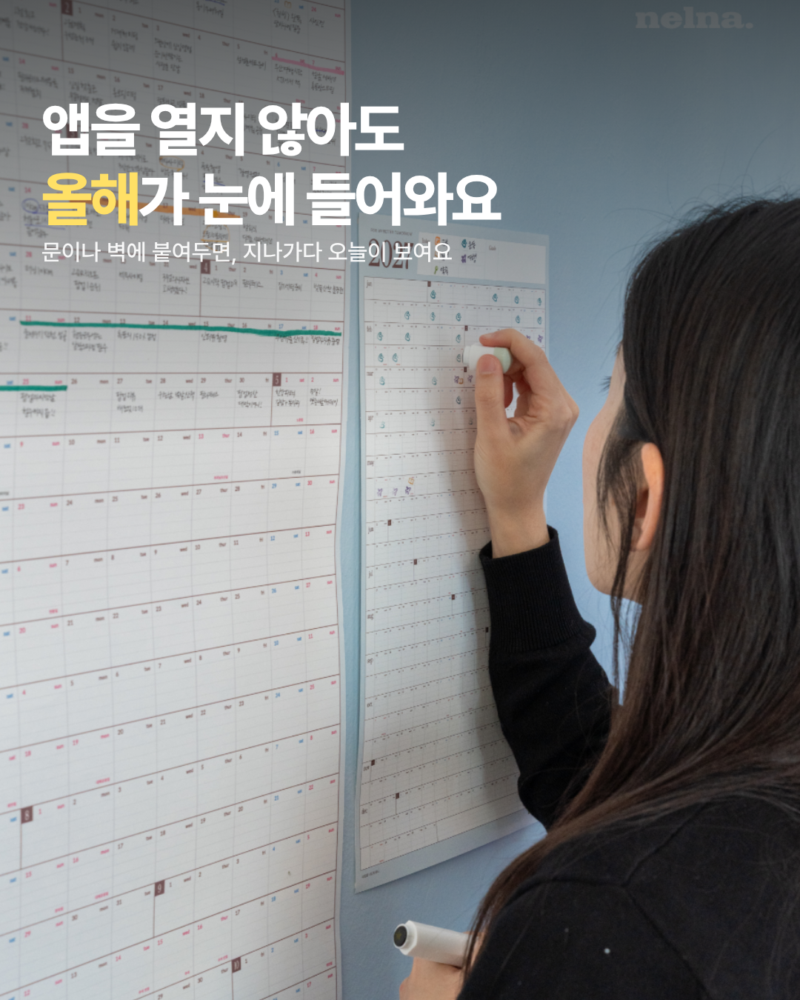

- **메타 헤드라인**: 앱 안 열어도 올해가 보여요
- **메타 설명**: 벽에 붙여두는 세로형 연력
- **CTA 버튼**: 더 알아보기
- **본문**:

  > 핸드폰 캘린더는 앱을 열어야 보이지만, 연력은 지나가다 눈에 들어와요.👀
  > ✅ 문이나 벽에 붙여두면 오늘이 며칠인지, 올해가 어디까지 왔는지 한눈에
  > ✅ 월 구분 없이 52주가 쭉 이어지는 세로형
  > ✅ 일정만 적어도 충분해요
  > 
  > 👉 자세히 보기
  > 
  > 𝙣𝙚𝙡𝙣𝙖.𝙨𝙝𝙤𝙥

#### 05-yeonryeok_n4

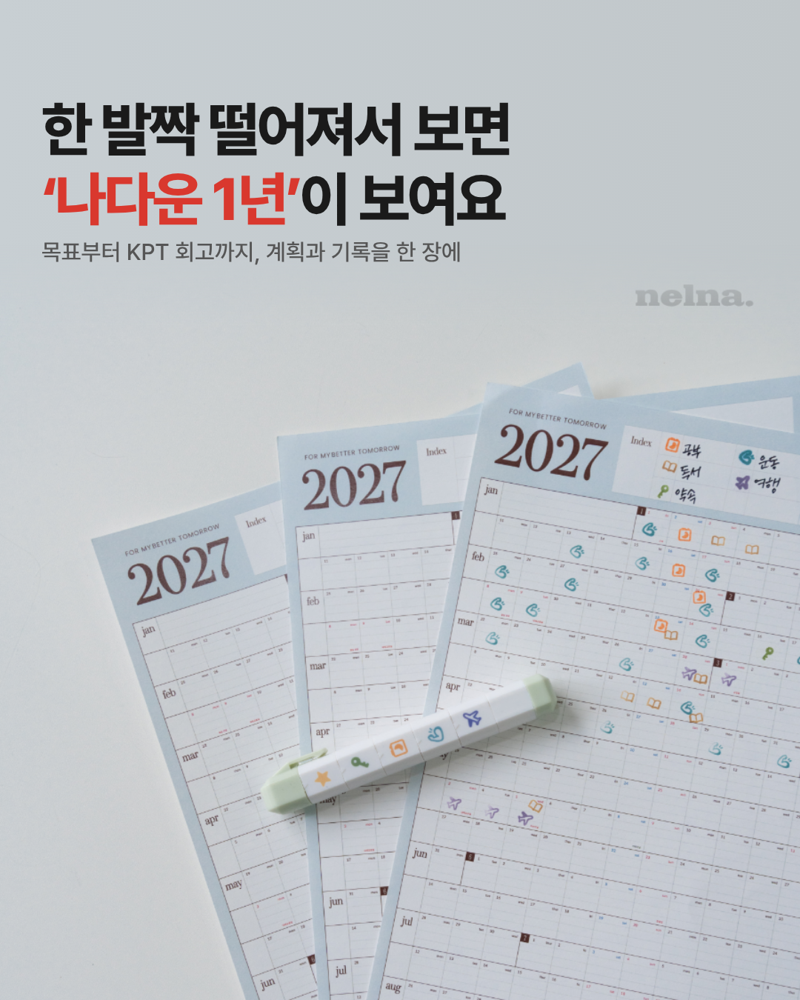

- **메타 헤드라인**: 나다운 1년이 한눈에
- **메타 설명**: 계획 + 기록 + 회고 한 장
- **CTA 버튼**: 더 알아보기
- **본문**:

  > 12월 말, 한 발짝 떨어져서 보면 ‘나다운 1년’이 보여요.✨
  > ✅ 위쪽엔 올해의 목표 · 중요 날짜 · 10키워드
  > ✅ 가운데는 52주 기록
  > ✅ 아래쪽엔 KPT 회고까지, 계획과 회고를 한 장에
  > 
  > 👉 자세히 보기
  > 
  > 𝙣𝙚𝙡𝙣𝙖.𝙨𝙝𝙤𝙥

#### 05-yeonryeok_n5

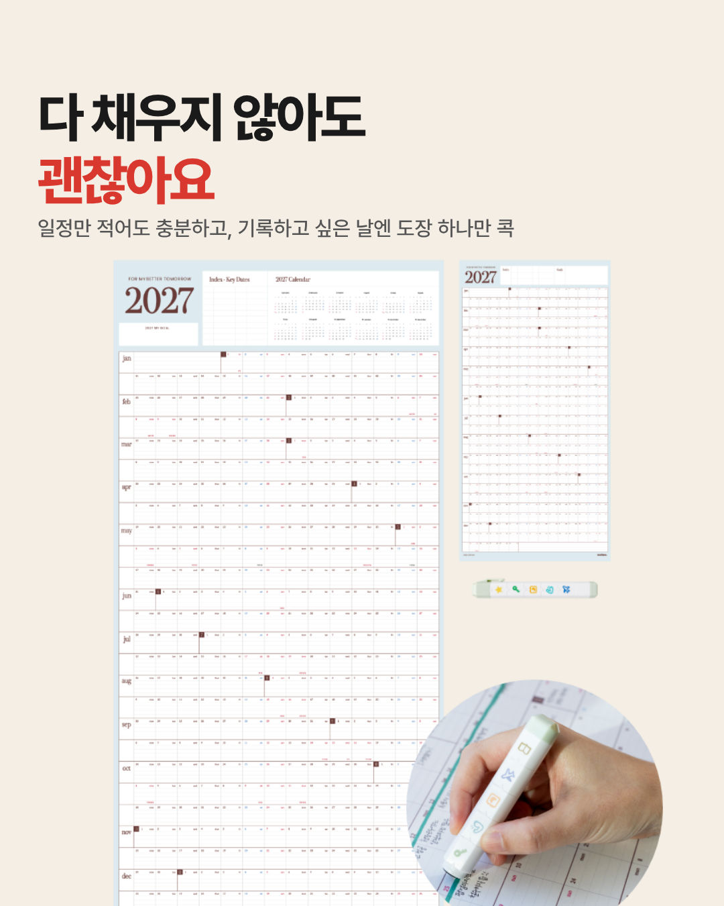

- **메타 헤드라인**: 다 채우지 않아도 괜찮아요
- **메타 설명**: 쓰기 부담 없는 기록 톤의 연력
- **CTA 버튼**: 더 알아보기
- **본문**:

  > 다 채우지 않아도 괜찮아요.🌿
  > 일정만 적어도 충분하고, 기록하고 싶은 날엔 도장 하나만 콕.
  > ✅ 쓰기 부담 없는 줄줄이 스탬프 6종
  > ✅ 180g 모조지로 구겨지지 않는 포스터
  > ✅ 2027년 한 해를 한 장에
  > 
  > 👉 자세히 보기
  > 
  > 𝙣𝙚𝙡𝙣𝙖.𝙨𝙝𝙤𝙥

#### 05-yeonryeok_f1

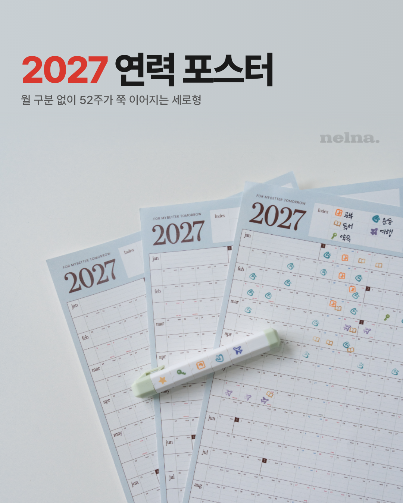

- **메타 헤드라인**: 2027 낼나 연력 포스터
- **메타 설명**: 월 구분 없이 52주가 이어지는 세로형 연력
- **CTA 버튼**: 더 알아보기
- **본문**:

  > 2027년 1년을 한 장으로 정리하세요.📅
  > ✅ 월 구분 없이 52주가 쭉 이어지는 세로형 포스터
  > ✅ 다음 달로 넘기는 귀찮음 없이, 한 해 일정을 한눈에
  > ✅ 잘 보이는 곳에 붙여두는 연력
  > 
  > 👉 자세히 보기
  > 
  > 𝙣𝙚𝙡𝙣𝙖.𝙨𝙝𝙤𝙥

#### 05-yeonryeok_f2

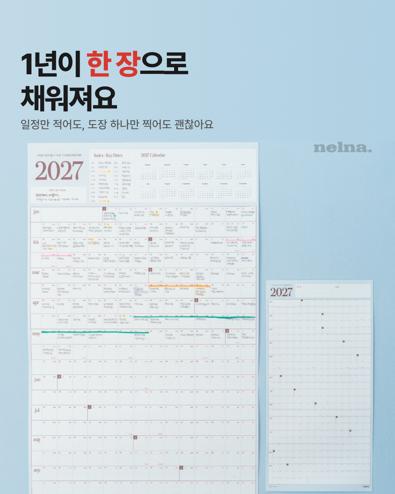

- **메타 헤드라인**: 1년이 한 장으로 채워져요
- **메타 설명**: 일정은 적고, 기록은 도장 콕
- **CTA 버튼**: 더 알아보기
- **본문**:

  > 1년이 한 장으로 채워져요.🖍️
  > ✅ 일정만 적어도 충분하고
  > ✅ 기록하고 싶은 날엔 줄줄이 스탬프 콕
  > ✅ 다 채우지 않아도 괜찮아요
  > 
  > 👉 자세히 보기
  > 
  > 𝙣𝙚𝙡𝙣𝙖.𝙨𝙝𝙤𝙥

### 영상 스크립트 (15~20초 · 9:16 릴스 (연말 회고용))

| 구간 | 내용 |
|---|---|
| 0–3초 | [훅] 벽에 붙은 연력 전체 샷에서 천천히 줌아웃. 자막 “12월 말, 한 발짝 떨어져서 보면” |
| 3–10초 | [기록] 도장 콕콕 찍는 ASMR(줄줄이 스탬프 6종) → 52주가 도장으로 채워지는 타임랩스 |
| 10–15초 | [회고] 아래쪽 KPT 회고 작성. 자막 “‘나다운 1년’이 보여요” |
| 15–20초 | [CTA] 연력 + 책상용 미니 연력 + 19,500원. 자막 “다 채우지 않아도 괜찮아요” |

---

## 낼나 2027 그랩&스크랩 박스 (34,500원)

### 집행 전 확인

- 타임캡슐은 **개봉 시점이 “2027년 말”**임을 분명히 쓰세요(소재에 반영).
- 2027 낼나다이어리 7,000원 쿠폰은 **사용 조건 · 기간** 확인 후 노출하세요(소재에는 넣지 않았습니다).
- 액자 사이즈는 290×290×45mm. 소재에서 크기 오해가 없도록 실제 손 · 책상 비교 컷이 있으면 좋습니다.

### 소재

#### 06-grabscrap_c1 · statement · 연말 감성 · 선물 소구

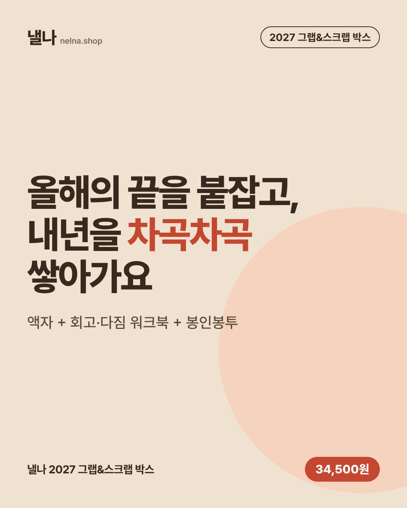

- **이미지 문구**: 올해의 끝을 붙잡고, 내년을 차곡차곡 쌓아가요
- **메타 헤드라인**: 올해의 끝, 내년의 시작
- **메타 설명**: 액자 + 워크북 + 봉인봉투 올인원
- **CTA 버튼**: 지금 쇼핑하기
- **본문**:

  > 연말 회고, 새해 다짐, 2027년의 추억까지.
  > 액자 하나로 올해를 정리하고 내년을 시작해요. 하루 만에 한 해를 정리하는 5개 카테고리 워크북 포함.

#### 06-grabscrap_c2 · stat · 경험 소구(개봉) · 반응 높을 훅

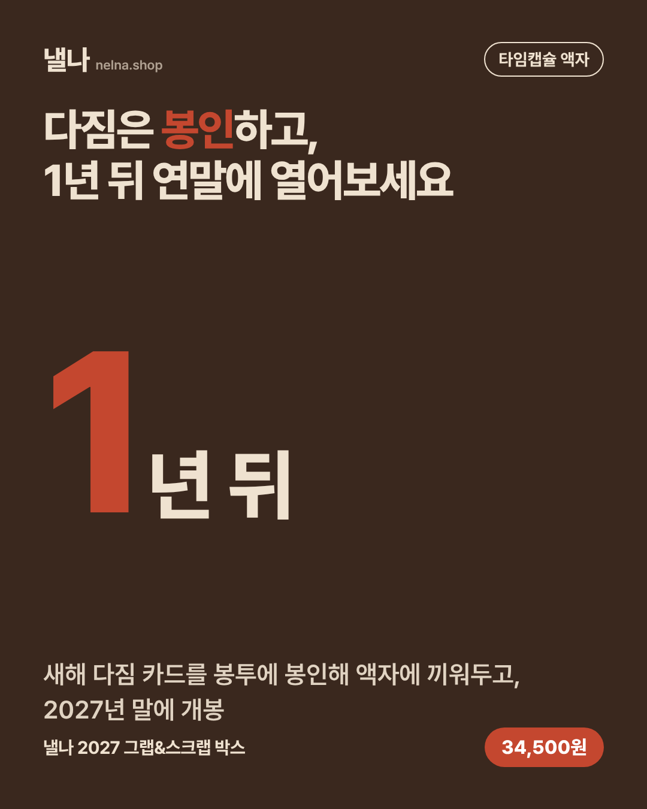

- **이미지 문구**: 다짐은 봉인하고, 1년 뒤 연말에 열어보세요
- **메타 헤드라인**: 나에게 보내는 타임캡슐 액자
- **메타 설명**: 2027년 말에 열어보세요
- **CTA 버튼**: 더 알아보기
- **본문**:

  > 다짐은 봉인하고, 1년 뒤 연말에 열어보세요.
  > 새해 다짐 카드를 봉투에 넣어 액자에 끼워두면, 2027년 말 나에게 보내는 타임캡슐이 됩니다.

#### 06-grabscrap_c3 · statement · 인테리어 소구

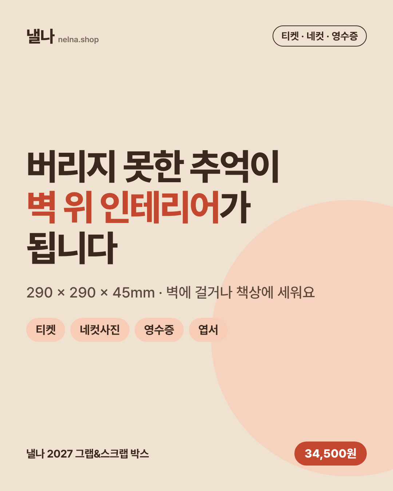

- **이미지 문구**: 버리지 못한 추억이 벽 위 인테리어가 됩니다
- **메타 헤드라인**: 추억이 벽 위 인테리어가 됩니다
- **메타 설명**: 티켓·네컷·영수증·엽서 액자
- **CTA 버튼**: 지금 쇼핑하기
- **본문**:

  > 티켓, 네컷, 영수증, 엽서. 버리지 못한 추억을 꽂아두면 그대로 인테리어가 됩니다.
  > 벽에 걸거나 책상에 세워두세요.

### 제품 사진 합성 시안

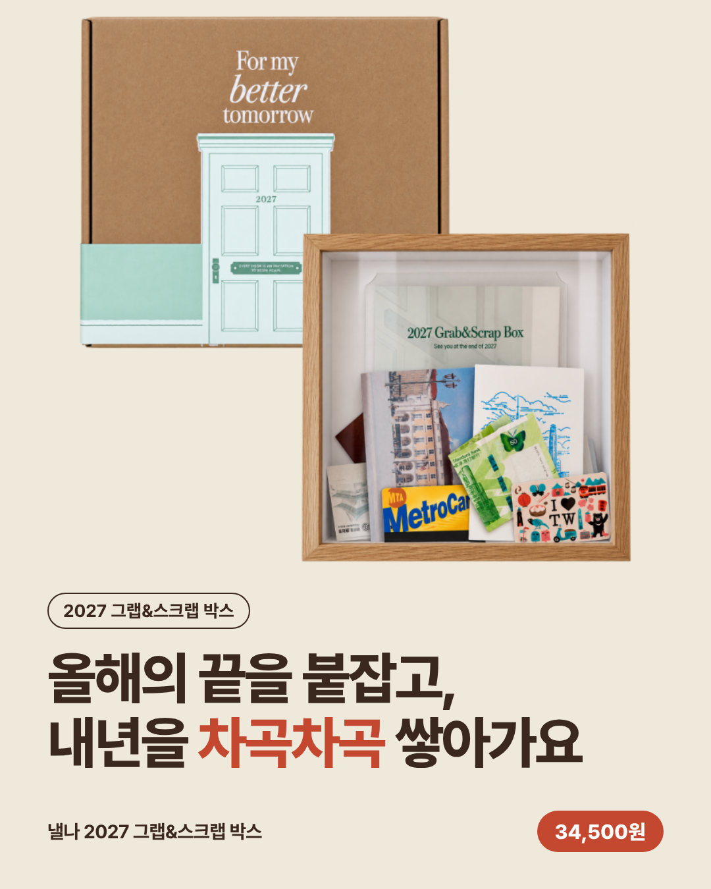

- 06-grabscrap_p1 · 본문·헤드라인·CTA는 **c1** 와 동일 · 스토리/릴스 커버 있음

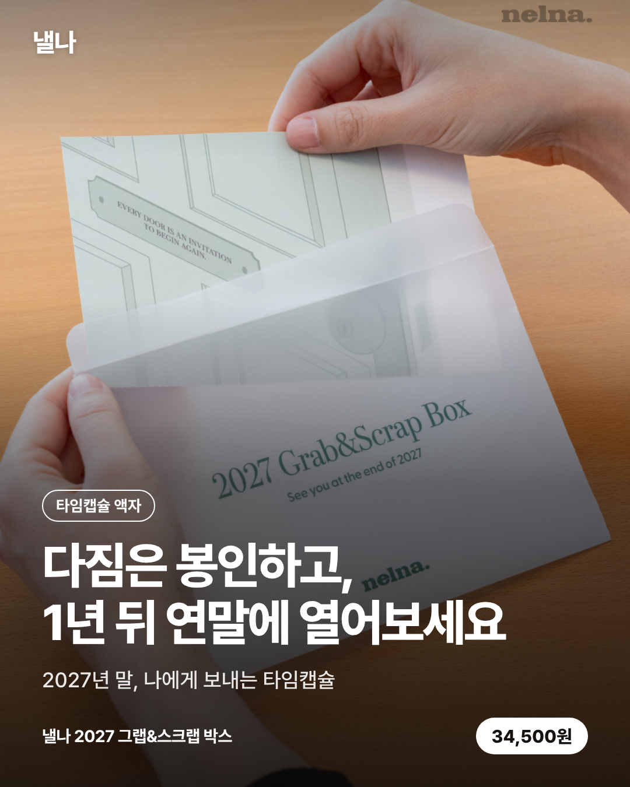

- 06-grabscrap_p2 · 본문·헤드라인·CTA는 **c2** 와 동일

### 영상 스크립트 (20초 · 9:16 릴스)

| 구간 | 내용 |
|---|---|
| 0–3초 | [훅] 서랍에서 구겨진 영수증 · 티켓 · 네컷이 쏟아짐. 자막 “버리지 못한 추억” |
| 3–9초 | [정리] 액자에 하나씩 꽂는 ASMR → 벽에 걸림. 자막 “벽 위 인테리어가 됩니다” |
| 9–15초 | [타임캡슐] 새해 다짐 카드를 봉투에 봉인해 액자에 끼움. 자막 “1년 뒤 연말에 열어보세요” |
| 15–20초 | [CTA] 워크북 + 액자 + 봉인봉투 올인원. 34,500원 |

---

## 낼나 플레이온 키링 어댑터 (23,200원)

### 집행 전 확인

- “30W”는 최대 출력입니다. **2포트 동시 사용 시 포트별 출력 분배**를 확인해 각주에 넣으세요.
- 88g는 **어댑터 + 커버 합계 기준**입니다(소재에 각주 반영). “스마트폰 절반 이하”는 비교 모델을 확인하세요.
- KC 인증 · 생산물배상책임보험 1억원은 증빙 서류를 확인하고 사용하세요(소재 본문에서만 사용).
- 메타 광고에서는 “MP3 플레이어”로 오인한 클릭을 막기 위해 **두 번째 컷에서 충전기임을 곧바로 공개**하세요. 반전 훅이지만 오해 유도가 되지 않게 해야 합니다.

### 소재

#### 07-playon_c1 · chat · 반전 훅 · 소재 임팩트 최상 (우선 테스트)

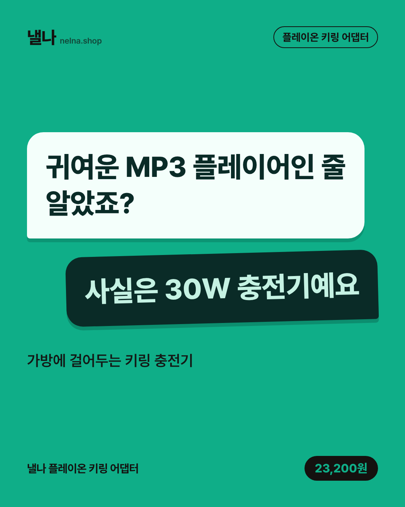

- **이미지 문구**: 귀여운 MP3 플레이어인 줄 알았죠? / 사실은 30W 충전기예요
- **메타 헤드라인**: 이거, 사실 충전기예요
- **메타 설명**: 30W USB-C · 포트 2개 동시 충전
- **CTA 버튼**: 지금 쇼핑하기
- **본문**:

  > 귀여운 MP3 플레이어인 줄 알았죠? 사실은 30W USB-C 충전기예요.
  > 레트로 감성 키링 디자인에 렌티큘러 카드로 꾸미는 재미까지.

#### 07-playon_c2 · statement · 발상 전환

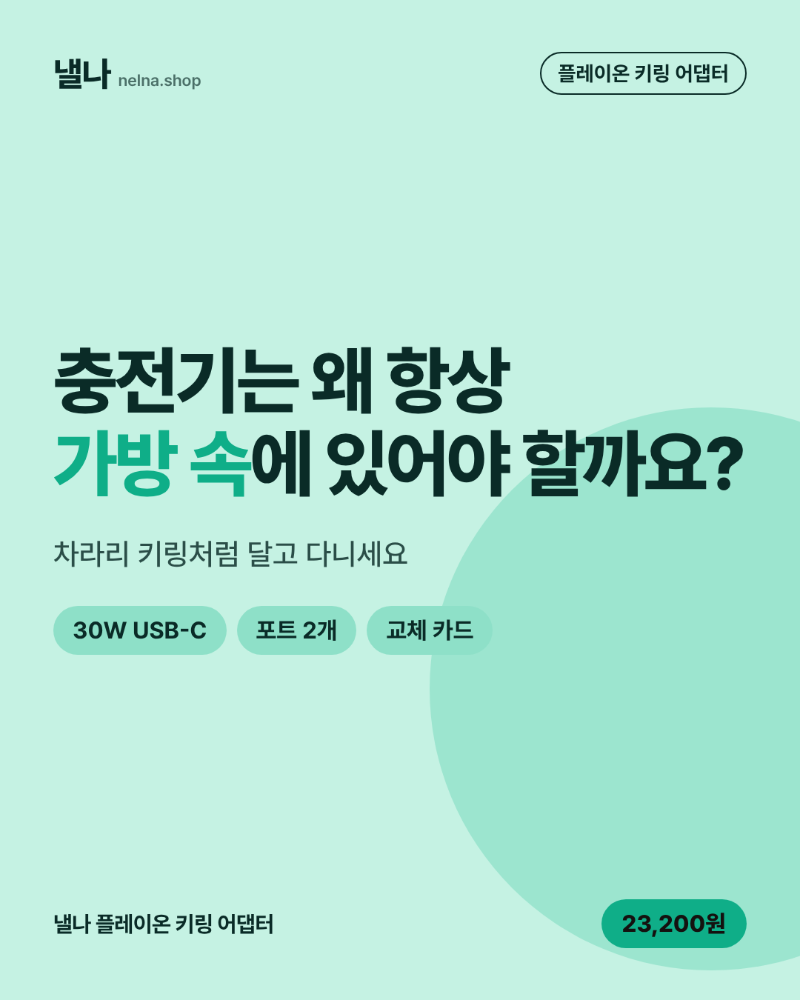

- **이미지 문구**: 충전기는 왜 항상 가방 속에 있어야 할까요?
- **메타 헤드라인**: 충전기를 키링처럼
- **메타 설명**: 폰 + 이어폰 동시 충전
- **CTA 버튼**: 더 알아보기
- **본문**:

  > 충전기는 왜 항상 가방 속에 있어야 할까요?
  > 차라리 키링처럼 달고 다니세요. 폰과 이어폰을 동시에 충전하는 30W 키링 충전기.

#### 07-playon_c3 · stat · 무게 소구 + 안전성 신뢰

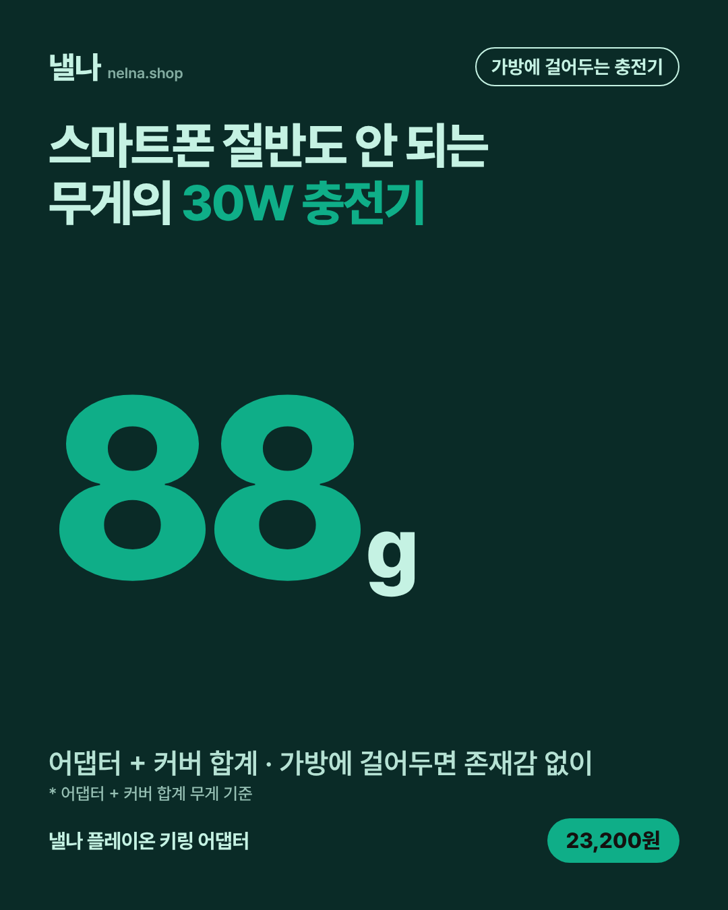

- **이미지 문구**: 스마트폰 절반도 안 되는 무게의 30W 충전기
- **메타 헤드라인**: 88g, 가방에 걸어두는 충전기
- **메타 설명**: KC 인증 · 보험 가입
- **CTA 버튼**: 지금 쇼핑하기
- **본문**:

  > 스마트폰 절반도 안 되는 88g. 가방에 걸어두는 30W 충전기.
  > KC 인증, 생산물배상책임보험 1억원 가입으로 안심하고 쓰세요.

### 제품 사진 합성 시안

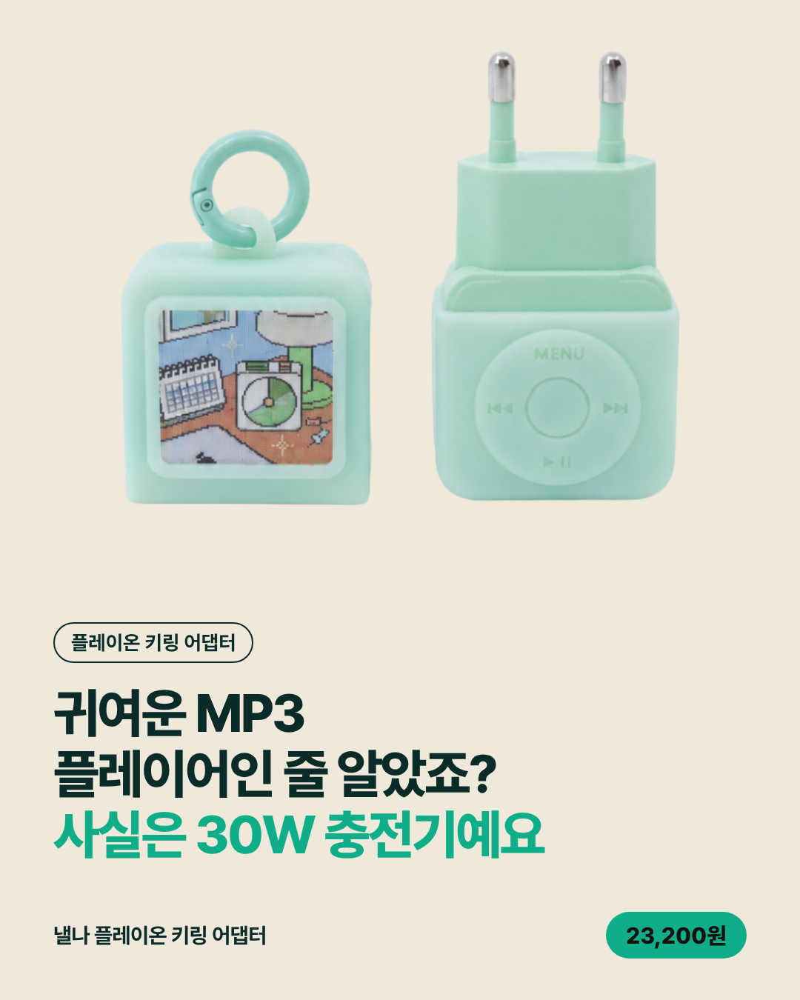

- 07-playon_p1 · 본문·헤드라인·CTA는 **c1** 와 동일 · 스토리/릴스 커버 있음

- 07-playon_p2 · 본문·헤드라인·CTA는 **c2** 와 동일

### 영상 스크립트 (15초 · 9:16 릴스 (가장 임팩트 큰 훅))

| 구간 | 내용 |
|---|---|
| 0–2초 | [훅] 민트 반투명 MP3 플레이어처럼 생긴 물건을 가방에 거는 장면. 자막 “귀여운 MP3 플레이어인 줄 알았죠?” |
| 2–5초 | [반전] 폰 케이블을 꽂음 → 충전 시작. 자막 “사실은 30W 충전기예요” |
| 5–11초 | [디테일] 렌티큘러 카드 교체, 포트 2개(폰 + 이어폰) 동시 충전. 무게 88g |
| 11–15초 | [CTA] 가방에 걸린 채로 충전하는 장면 + 23,200원 |

---

## 2027 낼나다이어리 (에센셜 16,900원 · 시그니처 19,900원)

### 집행 전 확인

- 구글캘린더는 **자동 동기화가 아니라 “일정 추가 링크”** 방식입니다. 소재 각주에 반영했고, “연동” “동기화”라는 단어는 쓰지 마세요.
- 에센셜(67p) / 시그니처(201p)는 가격이 달라서 **소재마다 어느 버전인지** 분명히 하세요(헤드라인에 버전 미표기 소재는 두 버전 가격 병기).
- 15개월(2026.11~2028.1)은 현재(2026년 11월)에 사도 15개월이라는 장점이지만, **2026년 12월 이후엔 사용 가능 개월이 줄어** “15개월 구성”으로 표현을 바꾸세요.

### 소재

#### 08-diary_c1 · statement · 수정 스트레스 공감 훅 (우선 테스트)

- **이미지 문구**: 계획은 늘 바뀌어요. 그래도 괜찮아요
- **메타 헤드라인**: 계획은 늘 바뀌어요, 괜찮아요
- **메타 설명**: 2027 낼나다이어리 · 에센셜 / 시그니처
- **CTA 버튼**: 지금 쇼핑하기
- **본문**:

  > 계획은 늘 바뀌어요. 그래도 괜찮아요.
  > 몇 번을 고쳐도 지운 흔적도, 스트레스도 남지 않는 낼나 디지털 플래너. 계획대로 안 된 날엔 →표시로 이어가면 돼요.

#### 08-diary_c2 · chat · 직장인 타깃 · 기능 소구 · 정확한 표현 필수

- **이미지 문구**: 회의에서 잡은 일정, 아이콘 한 번이면 / 구글캘린더로
- **메타 헤드라인**: 일정 아이콘 한 번이면
- **메타 설명**: 구글캘린더 일정 추가 링크
- **CTA 버튼**: 더 알아보기
- **본문**:

  > 회의에서 잡은 일정, 아이콘 한 번이면 구글캘린더 일정 추가 화면으로 연결돼요.
  > (자동 동기화가 아닌 일정 추가 링크 방식)

#### 08-diary_c3 · stat · 시즌 타깃팅 (지금 구매 이유)

- **이미지 문구**: 11월에 사도 연말부터 끊김 없이
- **메타 헤드라인**: 11월에 사도 15개월
- **메타 설명**: 연말부터 이어 쓰는 낼나다이어리
- **CTA 버튼**: 지금 쇼핑하기
- **본문**:

  > 11월에 사도 15개월. 연말부터 이어 쓰는 낼나다.
  > 2026년 11월~2028년 1월까지, 연말연초가 끊기지 않는 구성이에요.

#### 08-diary_c4 · list · 작심삼일 공감 · 버전 가격 병기

- **이미지 문구**: 다이어리, 3개월마다 다시 시작할 수 있게 만들었어요
- **메타 헤드라인**: 3개월마다 다시 시작해요
- **메타 설명**: 분기별 패스포트 · 에센셜 / 시그니처
- **CTA 버튼**: 더 알아보기
- **본문**:

  > 잘 쓰는 사람만 끝까지 쓰는 플래너가 아니라, 누구나 12월까지 이어 쓰는 플래너.
  > 3개월마다 다시 시작하는 분기별 패스포트로 작심삼일을 끊어보세요.

### 영상 스크립트 (15초 · 9:16 릴스)

| 구간 | 내용 |
|---|---|
| 0–3초 | [훅] 종이 다이어리에 일정을 지우개로 박박 지우다 찢어짐. 자막 “계획은 늘 바뀌어요” |
| 3–7초 | [전환] 디지털 플래너에서 →로 이어가기 한 번에. 자막 “그래도 괜찮아요” |
| 7–12초 | [기능] 일정 아이콘 터치 → 구글캘린더 일정 추가 화면. 분기별 패스포트(워크북 + 스티커) 컷 |
| 12–15초 | [CTA] 자막 “11월에 사도 15개월” + 에센셜 16,900 / 시그니처 19,900 |
